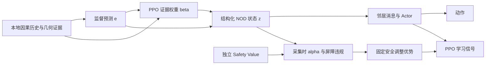

# 归档说明

此文件保存 2026-10-14 主线定稿之前的方案演化、训练诊断与评估记录。下文的“推荐”“最新方案”等措辞属于当时的探索记录，不定义论文当前主线。固定技术方案以 [LEARNING_IN_NOD_TECHNICAL_PLAN.md](../current/LEARNING_IN_NOD_TECHNICAL_PLAN.md) 为准。

---

# 学习如何进入 NOD：从证据与误差尺度比较到预测—控制分工的技术方案

更新日期：2026-10-14。用途：论文方法设计、贡献组织和实验解释的中文参考稿。

本文总结从“学习证据 e 还是学习方差”开始的方案演化，并以当前代码、训练记录和独立评估结果为依据。保留原公式的设计主线是**监督预测未来 e、PPO 学习共享 A**。首轮与联合适应两次尝试均已完成训练和独立评估，当前没有体现相对固定 A 的控制优势；独立 β 扩展仍是本轮比较中车车安全最好的候选。联合适应缓和了训练退化，但 A 偏移很小。若保留原公式，当前性能依据支持固定 A 候选；若优先车车避碰，支持保留 β 候选。方法设计偏好与已有性能结论应分开表述。项目默认测试模型仍为原 `reward7.18`，本文不改变默认配置。机制与结果见第 13 节，后续训练修改及结果见第 14 节。

## 1. 推荐主线与研究问题

**监督学习预测邻车未来能提供多少风险缓解；强化学习决定如何将这个预测融入意见；结构化 NOD 将预测和控制连接为具有记忆的交互状态。**

异构交通中，本车既不知道邻车的策略，也不能依赖邻车提供动作计划。仅从当前减速推断“合作”，可能把前车阻挡、本车自行避让或道路几何造成的变化误解为邻车的主动帮助。即使已经预测出邻车未来的风险缓解，固定强度地使用这一预测也未必适合每一种控制状态。

因此，本文应围绕两个不同问题组织学习：

1. **预测问题**：截至当前的局部历史，能够预测邻车相对指定参考运动的未来风险缓解吗？
2. **控制问题**：在本车当前状态和安全—任务目标下，应以多大强度吸收这个预测？

监督预测头回答第一个问题，PPO 学习原方程中的关注 A 回答第二个问题。A 同时调节历史意见自强化和新证据吸收，不能仅解释为证据权重。NOD 的作用是提供显式、有界、可分析的意见演化，而 Actor 学习如何将这些交互信息转化为动作。这一分工不要求证明强化学习普遍优于监督学习。

建议的核心表述：

> 我们构建一种预测与控制分工的意见驱动学习框架。通过反事实轨迹监督预测邻车的未来风险缓解，并通过安全强化学习调节非线性意见动力学中的共享关注系数，从而形成面向控制任务的动态交互意见。

这里的“安全强化学习”指当前 Safety Value 与安全调整优势参与 PPO 学习，不意味着部署时具有逐动作的安全认证。

## 2. 方案演化：各次比较到底比较了什么

| 阶段 | 证据来源 | 被学习的量 | 主要认识 |
| --- | --- | --- | --- |
| 原责任意见 | 当前在线几何反事实证据 | 风险关注 A、历史编码、方差 | 可形成意见，但方差接近下限，可靠性语义不清楚 |
| 固定小方差 | 原几何证据 | A、历史编码 | 表现接近原候选，原方差在该设置中近似常量 |
| 学习当前证据 | 用历史拟合当前几何证据 | e、A、历史编码；方差固定 | 当前教师已经可计算，预测器又缺少显式参考信息，收益不明显 |
| 候选 NOD 从头初始化 | 与上一阶段相同 | 仅 learner NOD 从随机权重开始 | 未恢复证据拟合和意见关联，初始化不能解释全部问题 |
| 独立误差尺度 | 保留几何证据 | 证据对未来目标的预计平方误差、A、历史编码 | 尺度获得误差排序能力，但不是已校准的噪声方差 |
| 学习未来证据 | 历史与当前几何证据预测未来目标 | e、A、历史编码；方差固定为 1 | 预测具有独立任务，形成明确的物理监督语义 |
| 单步 PPO 权重 | 冻结的未来证据预测 | 新增控制权重 β，联合训练 Actor | 权重变化很小，KL 提前停止严重；第一轮车车安全更差 |
| 分阶段短序列 PPO 权重 | 同一冻结预测器 | β 先独训，再与 Actor 联训 | 更新显著增加；最佳模型车车安全改善，但有速度与平滑性代价 |
| 保留原公式的共享 A | 同一冻结预测器 | PPO 学习同时用于两项更新的 A；风险 A0 是冻结初始化先验 | 已完成 70 轮和独立评估；当前车车碰撞时间率高于固定 A |

不能将前两次“学习 e”混为一谈：**拟合当前已计算证据**与**预测尚未观察到的未来缓解**，目标、输入和损失都不同。早期失败不证明学习证据不适合 NOD；后期成功也不证明所有学习证据的方法都会有效。

“从头训练”的已完成尝试，只是候选 learner NOD 从头初始化，采样用 Actor、behavior NOD 和 Safety Value 仍来自已训练检查点，不能表述为整个系统从头训练。

## 3. 符号与物理意义

以下均针对有方向的车辆对 i→j，省略下标时表示同一条有效交互边。

| 符号 | 定义和角色 |
| --- | --- |
| H_t、h_t | 截至 t 的局部运动历史及其 GRU 编码 |
| e_t^geom | 基于已观察运动与交互参考计算的当前几何缓解证据 |
| q_t* | 用未来真实邻车轨迹生成的缓解比例监督目标，范围 [0,1] |
| e_t*=2q_t*−1 | 将未来目标中心化到 [−1,1] |
| q_hat_t、e_hat_t | 从当前因果信息预测 q_t* 及其中心化值 |
| A_t^0 | 基于物理风险的关注先验；候选阶段学习、控制阶段冻结 |
| A_t | 新推荐分支中由 PPO 学习的共享关注；同时用于自强化、证据融合和 Actor 上下文；历史 β 分支仍用 A 表示冻结先验 |
| v_t | 误差尺度分支中的预计平方误差；推荐主线固定 v_0=1 |
| β_t | 历史扩展分支中 PPO 学习的独立证据吸收强度；新共享 A 分支没有独立 β |
| z_t | 由动力学形成的有界交互意见，保留历史并参与控制 |
| α_t | 训练期成对 Safety Value 屏障系数，由采集时意见调节 |

q* 度量指定参考下的风险缓解，不等于主观合作意图。没有要求 q_ij+q_ji=1，也没有将两车的安全距离切分成可精确交接的份额。

候选监督阶段的 (z+1)/2 被训练去拟合 q*；引入 PPO 权重后，z 的合理解释是**面向控制任务、经历史融合的风险缓解意见**。它不再自动具有预测概率的校准含义。β 是控制使用强度，也不等于预测正确率、认知置信度或安全下界。

## 4. 未来风险缓解监督目标

### 4.1 构造方式

交互开始时保存因果速度参考，形成 v_i^anc、v_j^anc。在当前时刻 t 的未来 H 步窗口内，用同一个本车参考轨迹比较两种邻车运动：

\[
\bar p_i(t+k)=p_i(t)+k\Delta t\,v_i^{\rm anc},\qquad
\bar p_j(t+k)=p_j(t)+k\Delta t\,v_j^{\rm anc}.
\]

邻车真实轨迹为 p_j(t+k)。定义：

\[
R_t^0=\max_{1\le k\le H}
\exp\left(-\frac{\|\bar p_i(t+k)-\bar p_j(t+k)\|}{d_s}\right),
\]
\[
R_t^{\rm obs}=\max_{1\le k\le H}
\exp\left(-\frac{\|\bar p_i(t+k)-p_j(t+k)\|}{d_s}\right),
\]
\[
q_t^*=\operatorname{clip}\left(
\frac{R_t^0-R_t^{\rm obs}}{\max(R_t^0-R_s,\epsilon_R)},0,1\right),
\qquad e_t^*=2q_t^*-1.
\]

当前 d_s=0.2、R_s=exp(−1)、ε_R=10^−6，H=20、Δt=0.05 s，对应未来 1 s；交互参考最长保持时间为 2 s。这些是仿真尺度参数，不能直接套用到实际道路车辆。

q*=0 表示邻车相对参考未提供正向缓解；q*=1 表示按该风险模型已提供足够缓解；中间值表示部分缓解。它是连续软标签，BCE 不要求标签只能取 0 或 1。

### 4.2 有效样本与因果边界

监督要求潜在交互有效、未来窗口完整、本车与邻车身份/代际一致。轨迹末尾不完整窗口、重置及身份更换样本排除。在线可见掩码维护物理历史，交互掩码决定意见是否有意义；无交互显示 N/A，数值中性零不表示观察到“承担一半缓解”。

训练时可用未来轨迹生成目标，推理输入只包含当前及过去的观测。当前 e^geom 使用已观察运动形成在线证据，它与未来窗口目标不是同一个计算量。

固定本车参考可以避免直接把本车实际未来刹车造成的距离变化计入邻车贡献。但是邻车真实轨迹仍可能受本车行为影响；该指标没有执行真实因果干预，不能宣称识别了与本车行为完全独立的因果合作程度。参考轨迹、风险核、窗口与分母近零处理共同决定标签语义。

实现：[counterfactual.py](../../utilities/nod_marl/counterfactual.py)。

## 5. 已测 β 扩展：监督预测、独立控制权重与意见演化

本节保留已完成实验的确切定义。最新推荐分支不使用下式中相互独立的 A、β，改为第 13 节的共享 A；未来证据预测器和候选监督损失复用本节设计。

### 5.1 因果预测网络与损失

当前局部成对物理特征为 20 维，采用 GRUCell(20,64)：

\[
h_t=\operatorname{GRU}_\phi(x_t,h_{t-1}),\qquad
\hat q_t=\operatorname{sigmoid}(f_\phi([h_t,e_t^{\rm geom}])),\qquad
\hat e_t=2\hat q_t-1.
\]

预测头为 `Linear(65,64) → Tanh → Linear(64,1)`；末层零初始化，初始预测 q_hat=0.5。补充 e^geom 使网络显式接收交互参考形成的证据，而不要求仅靠隐藏向量重建全部参考信息。

候选阶段 β=A，固定 b=0、s=1、v_0=1。损失为：

\[
\mathcal L_{\rm forecast}=\operatorname{BCE}(\hat q_t,q_t^*),\quad
\mathcal L_{\rm opinion}=\operatorname{BCE}\left(\frac{z_t+1}{2},q_t^*\right),\quad
\mathcal L_{\rm candidate}=\mathcal L_{\rm forecast}+\mathcal L_{\rm opinion}.
\]

预测损失更新预测头与 GRU；意见损失通过隐式求解器更新预测头、GRU 与风险关注参数。当前不加入旧观测证据 NLL，也不加入拟合几何教师的 Huber 损失。Brier/ECE 是诊断，不是新增优化目标。

单独的软标签 BCE 在理想函数容量下以条件均值为最优解；当前还存在联合意见损失、有限数据和有限容量，因此不能自动把 q_hat 称为校准的真实条件期望。

### 5.2 风险基准 A 与 PPO 权重 β

A 由六个非负物理风险分量及非负可学习权重构造：

\[
A_t=\operatorname{sigmoid}\left(T_r\left[\sum_{m=1}^{6}\omega_m r_{m,t}-c_r\right]\right),
\qquad \omega_m=\omega_{\max}\operatorname{sigmoid}(u_m).
\]

因此它对各风险分量结构上非递减；候选阶段由意见损失间接学习，没有单独的“正确 A”标签。局部运动学模式清零了邻车路径相关槽位，六个风险分量并非全部都提供有效变化，主要变化来自距离、接近程度与 TTC。

控制阶段冻结 A，另设：

\[
\xi_t=[h_t,r_t,A_t,\hat e_t,z_{t-1}],\qquad
\beta_t=\operatorname{sigmoid}\left(
\operatorname{logit}(\bar A_t)+c_\beta\tanh(g_\theta(\xi_t))\right).
\]

其中 A_bar 将 A 裁剪至 [10^−6,1−10^−6]。g_theta 为 `Linear(73,32) → Tanh → Linear(32,1)`，共 2401 个参数，c_beta=2。末层零初始化，使 β≈A。权重调节有幅度限制，无有效交互时置零；这个限制不提供物理安全保证。

**该历史分支是“监督学习 e 与风险基准 A，强化学习 β”，不能写成“原 A 已改由 RL 学习”。** A 保留风险相关的自强化作用，β 调节新证据的吸收，两者在动力学中的位置不同。第 13 节新增分支才把 PPO 输出用于原共享 A 的两个位置。

### 5.3 NOD 更新与结构性质

令 λ=τ/Δt，当前 τ=0.25 s、Δt=0.05 s，因此 λ=5。意见更新为：

\[
\lambda[\operatorname{atanh}(z_t)-\operatorname{atanh}(z_{t-1})]
=-z_t+A_t\tanh(a z_t)+\frac{w\beta_t}{v_0}(\hat e_t-z_t),
\]

当前 a=2、w=1、v_0=1。左侧提供 Bernoulli KL 几何下的历史惯性；−z 提供衰减；A tanh(az) 提供风险相关自强化；最后一项吸收预测证据。

定义 ρ(z)=(z+1)/2，同一更新可由标量目标的一阶条件得到：

\[
\Phi_t(z)=\frac{z^2}{2}-\frac{A_t}{a}\log\cosh(az)
+\frac{w\beta_t}{2v_0}(z-\hat e_t)^2
+\lambda D_{\rm KL}(\operatorname{Bern}(\rho(z))\|\operatorname{Bern}(\rho(z_{t-1}))).
\]

求解时固定该步 β；其取值由上一意见及当前缓存计算，并不依赖正在求解的 z_t。曲率为：

\[
H_t(z)=\frac{\lambda}{1-z^2}+1-A_ta\operatorname{sech}^2(az)+\frac{w\beta_t}{v_0}.
\]

在 0≤A≤1、β≥0、v_0>0、w≥0、λ>0、a>0 且 λ+1>a 时，H_t>0，精确标量问题具有唯一最小点。代码在 (−1+10^−4,1−10^−4) 内有限次求根，应区别数学解与数值近似。

固定其他输入时：

\[
\frac{\partial z_t}{\partial\hat e_t}=\frac{w\beta_t}{v_0H_t}\ge0,\qquad
\frac{\partial z_t}{\partial\beta_t}=\frac{w(\hat e_t-z_t)}{v_0H_t}.
\]

因此，增加 β 将意见向预测证据方向拉动；它可能强化正意见，也可能强化负意见，不能解释为“β 越大越合作”或“越安全”。这些局部性质还需固定 β 或其他网络输出，不能直接推及所有输入变化下的复合网络或闭环轨迹。

固定 b=0、s=1 保留结构化证据映射；在 e_hat=0、z_{t−1}=0 时，中性零点是更新平衡点。但不能声称该映射总是保持历史意见与当步证据同号，自强化与历史惯性仍可能保留前一阶段的符号。

实现：[opinion.py](../../utilities/nod_marl/opinion.py)、[policy.py](../../utilities/nod_marl/policy.py)。

## 6. 已测 β 扩展如何影响控制，以及梯度经过哪里

### 6.1 Actor 消息路径

每条可见边的上下文是 [h_t(64),r_t(6),A_t(1),z_t(1)]，共 72 维。消息网络为 `LayerNorm(72) → Linear(72,64) → Tanh → Linear(64,32) → Tanh`，以共享打分头、masked softmax 聚合邻居，再用 0.1 tanh 限制消息幅度。

Actor 输入为 [本车原始观测 D_o,消息 32,上一动作 2]；共享分散式两层 256 单元 Tanh MLP 输出二维动作分布参数，经过有界分布产生动作。部署时只需要本地观测、冻结预测器、β 网络、意见状态与 Actor。

Actor 同时接收历史编码和风险特征，所以 z 不是所有邻居信息必须经过的唯一瓶颈。论文应把“结构化意见提供可分析的动态通道”与“Actor 实际使用该通道”分开讨论。

### 6.2 Safety Value 与训练优势路径

PairSafetyValue 是独立于任务 Critic 的状态风险网络，输出成对、道路和实际碰撞约束头。它使用宽度 64 的共享边/本车编码与邻居 masked mean；成对头输入为 192 维，本地道路/碰撞头输入为 128 维。当前以多步最大风险 λ 目标进行独立 MSE 回归，γ_V=0.99、λ_V=0.95，目标 detach。

对有效成对约束定义：

\[
\delta_{ij,t}=\frac{V_{ij}(s_{t+1})-V_{ij}(s_t)}{\Delta t}+\alpha_{ij,t}V_{ij}(s_t).
\]

只在安全侧、物理约束非正、意见身份有效且 |z|>0.1 时使用：

\[
\alpha_{ij,t}=\alpha_0+\Delta\alpha\operatorname{clip}(kz_{ij,t},-1,1),
\qquad \alpha_0=10,\ \Delta\alpha=5,\ k=1.
\]

危险侧、意见缺失或死区内回退基础规则，道路和实际碰撞头不由意见调节。在 V<0 时，正意见使同一转移的 δ 更小，负意见使其更大；变化的是接近安全边界的训练压力，物理安全距离保持不变。

gated 更新在出现有效 δ>0 时删除任务优势，并扣减最大安全违规惩罚。用 κ 表示安全惩罚权重，避免与证据 β 混淆：

\[
\hat{\mathcal A}_t=
\mathbf1_{\text{无已知违规}}\hat{\mathcal A}^{\rm task}_t
-\kappa\max_{c\in\mathcal C_t}[\delta_{c,t}+\epsilon]_+,
\qquad \kappa=1,\ \epsilon=0.01.
\]

该表达适用于约束完整或已有明确违规的样本；未知后继且无已知违规时回退任务优势。约束头有效性、身份连续性和终止处理不能省略。

### 6.3 β 的强化学习目标与隔离

定义新旧动作概率比 r_theta，用已固定的安全调整优势构造 PPO 目标：

\[
\mathcal L_{\rm actor}=-\mathbb E\left[
\min(r_\theta\hat{\mathcal A},\operatorname{clip}(r_\theta,1-\epsilon_{\rm PPO},1+\epsilon_{\rm PPO})\hat{\mathcal A})\right]
-c_H\mathbb E[\mathcal H(\pi)].
\]

β 没有监督标签、专属奖励或第二个任务 Critic。其梯度路径为 θ→β→重算 z→消息→动作对数概率/熵→PPO。预测器与 A 冻结；Safety 优势按采集意见提前构造并 detach，梯度不穿过 α、违规门控、Safety Value 或环境转移。

β 可以改变未来采样的意见与 α，从而改变后续批次的学习信号；这与当前批次对 α 求导是两回事。图中不应画成“β 通过可微屏障直接反传安全损失”。



实现：[dgppo.py](../../utilities/nod_marl/dgppo.py)、[safety_value.py](../../utilities/nod_marl/safety_value.py)、[mappo_cavs.py](../../utilities/mappo_cavs.py)。

## 7. 已完成 β 分支的训练流程

### 7.1 候选预测器训练

冻结 behavior Actor、behavior NOD、任务 Critic 与 Safety Value 采集轨迹，独立 learner NOD 更新。两套 NOD 分开，避免预测器变化通过 Actor 输入立即改变自己的训练分布。

未来证据候选与误差尺度候选均使用固定 `reward7.21` 行为源、同种子和 30 轮预算。NOD Adam 学习率 10^−3，4 个 epoch，32 步监督序列、最多 8 个环境组成小批量。未来目标只进入损失。既有日志中两分支行为回报与碰撞标记序列相同，支持采样隔离，但不等于已经证明每个原始张量完全一致。

### 7.2 固定预测器的控制训练

未来证据固定权重分支冻结预测器，训练 Actor、消息、任务 Critic 与 Safety Value；β=A。完成 70 轮，包含 20 轮 Safety warmup，得到 `reward7.08`。

已完成的短序列 β 分支从这个完整检查点初始化，再增加新 β：

| 轮次 | 策略参数更新 | 其他更新 |
| --- | --- | --- |
| 1–20 | Actor、消息、β 均冻结 | Safety Value warmup |
| 21–30 | 只更新 β；主干/消息参数梯度置 None | 任务 Critic、Safety Value 继续训练 |
| 31–70 | β 与主干/消息联合微调 | 任务 Critic、Safety Value 继续训练 |

预测器、GRU、A 和 v_0 全程固定。初始 Actor/消息/任务 Critic LR 为 10^−5，β LR 为 5×10^−5，沿用衰减；KL 阈值保持 0.01，不提高意见增益。阶段计数仅在发生 PPO 更新的批次递增，并随策略检查点保存。

### 7.3 有序短序列回放

每个环境的 128 步切为 16 个独立的 8 步窗口，64 个窗口组成 512 帧小批次。窗口之间随机打乱，内部保持时间顺序。窗口首步使用 detach 的采集意见；后续连续有效同一车辆对递推：

\[
\widetilde z_t=F(\widetilde z_{t-1},A_t,\hat e_t,g_\theta(h_t,r_t,A_t,\hat e_t,\widetilde z_{t-1}),v_0).
\]

晚一步的动作损失能够沿意见状态影响前面的权重。车辆代际变化、邻居更换、交互失效、缓存中断与可用终止标记切断梯度；回放不推进在线 NOD。预测器隐藏状态缓存保持固定，所以这是仅通过意见状态的截断时间反向传播，不是全历史精确策略梯度，也不通过 GRU 或仿真器求导。

β 位于 `_policy.pth`，冻结预测器位于版本 8 的 `_nod.pth`。评估和恢复必须配套使用配置与完整检查点，不能只加载 NOD 侧文件来代表整个意见控制机制。

## 8. 已完成结果及其解释

### 8.1 早期当前证据拟合与随机初始化

下面是候选训练最后一轮诊断，不是新控制策略的独立测试：

| 候选 | 意见 Brier | 意见—未来目标相关系数 | 证据 MAE |
| --- | ---: | ---: | ---: |
| 固定小方差、继承初始化 | 0.19207 | 0.50788 | — |
| 学习当前证据、继承初始化 | 0.20098 | 0.31144 | 0.51799 |
| 固定小方差、learner 从头初始化 | 0.19167 | 0.50831 | — |
| 学习当前证据、learner 从头初始化 | 0.21224 | 0.30384 | 0.51552 |

固定尺度均约为 0.00673811，即原范围下限 exp(−5)。随机初始化没有恢复意见相关性，说明不能把问题仅归因于微调初始化。较小尺度会放大预测残差的损失，同时历史-only 的几何教师拟合又可能丢失参考信息。但这些是解释假设，不能由这四组结果单独证明其因果作用。此阶段未提供两个新控制策略的性能比较。

### 8.2 独立误差尺度与未来证据候选

误差尺度分支使用独立未来误差：

\[
\mathcal L_v=\frac12\left[
\frac{\operatorname{stopgrad}((e_t^{\rm geom}-e_t^*)^2)}{v_t}
+\log v_t+\log(2\pi)\right].
\]

意见求解对 v detach，避免意见 BCE 直接操纵该尺度。理想条件最优值是 E[(e_geom−e*)²|H_t]，包含系统偏差，并非纯观测噪声。范围改为 [exp(−5),4]，从 1 初始化。

两候选最后五轮平均诊断为：

| 诊断 | 学习未来证据 | 学习误差尺度 |
| --- | ---: | ---: |
| 意见 Brier | 0.15899 | 0.15858 |
| 意见 BCE | 0.60556 | 0.59814 |
| 意见—未来目标相关系数 | 0.53749 | 0.50827 |
| 意见 ECE | 0.18550 | 0.14970 |

未来预测头自身 Brier=0.11000，当前几何证据直接对同一未来目标评分为 0.22906；预测 q 的 MAE=0.24769、平均偏差=+0.01367。预测头与过滤后意见是不同输出，不能把前者的 0.11000 当成 z 的 Brier；过滤后的 Brier 更高也不能单独证明 NOD 对控制无用。

误差尺度平均误差相关系数为 0.33196；预测高尺度组实际平方误差约为低尺度组的 4.56 倍。它学到了训练分布上的误差排序，但末轮低尺度组预测 0.17975、实际误差 0.33269，仍有低估，不能称为已经校准。

两条路均有依据，没有出现学习方差全面胜过学习 e 的结果。它们使用不同目标、输入连接和梯度路径，是两种实现策略比较；误差尺度还同时改变了监督与允许范围，不能将改善全部归因于动态尺度本身。

### 8.3 独立控制评估汇总

协议统一为 `intersection_2`、32 个并行仿真、1200 请求步长、环境种子 101、确定性动作、关闭观测噪声和轨迹缓存。按各分支训练回报选取中间检查点。下表汇总三个已完成比较的导出指标，固定权重基线在多次运行中精确复现。

| 控制方案 | 检查点 | 车车碰撞率 %↓ | 道路碰撞率 %↓ | 归一化速度 %↑ | 中心线偏差 %↓ | 动作变化 %↓ |
| --- | --- | ---: | ---: | ---: | ---: | ---: |
| 几何证据＋独立误差尺度 | reward7.38 | 0.22936 | 1.56380 | 83.27902 | 56.07506 | 7.24631 |
| 未来证据＋固定 β=A | reward7.08 | 0.17462 | 1.66024 | 82.71497 | 54.34002 | 7.48459 |
| 未来证据＋单步 PPO β | reward6.95 | 0.28148 | 1.19892 | 83.62932 | 49.22356 | 7.16872 |
| 未来证据＋分阶段 8 步 PPO β | reward7.16 | **0.09904** | 1.63678 | 81.70083 | 56.85823 | 7.84812 |

未来证据固定权重相对误差尺度，车车碰撞率约降低 23.9%，速度下降约 0.564 个百分点；中心线偏差更小，动作变化略大。它提供更好的车车安全均值，但没有全面支配误差尺度方案。

单步 PPO β 相对固定 β，车车碰撞率增加约 61.2%，道路接触减少、速度与平滑性改善。这个结果体现取舍，不能写成强化学习权重已经改善车车安全。

新分阶段短序列 β 相对固定 β，车车碰撞率降低 **43.3%**，绝对减少 0.07558 个百分点；归一化速度下降 1.01414 个百分点；道路接触约降低 1.4%，中心线偏差增加约 4.6%，动作变化增加约 4.9%。它是当前优先车车避碰时值得保留的候选，尚不是所有指标都更好的模型。

同协议早期四方法结果还包括 SigmaRL：车车碰撞 0.35186%、速度 84.68028%；XP-MARL：车车碰撞 0.67244%、速度 81.54013%。这些是既有背景结果，不是专门针对新 β 分支重新完成的统一 SOTA 比较；额外训练预算、初始化及平滑性取舍也应在论文中报告，不能只摘取一个安全指标宣称整体最优。

统计口径：碰撞率是每个环境中至少一辆车发生相应碰撞的时间步比例，不是独立事故数量/概率；归一化速度优先使用整段未碰撞车辆，必要时回退全部车辆，不等于无条件车队吞吐量。中心线偏差以车辆宽度归一化。32 个并行仿真不等于 32 个独立环境种子的重复实验。目前没有跨训练种子、跨评估种子显著性或全场景优越性结论。

原始数据：[未来证据与误差尺度](../../outputs/benchmarks/future_evidence_vs_variance_paper_metrics/intersection_2/steps_1200_envs_32_seed_101/metrics_summary.json)、[单步 β](../../outputs/benchmarks/future_evidence_ppo_gate_paper_metrics/intersection_2/steps_1200_envs_32_seed_101/metrics_summary.json)、[分阶段短序列 β](../../outputs/benchmarks/future_evidence_ppo_gate_sequence_paper_metrics/intersection_2/steps_1200_envs_32_seed_101/metrics_summary.json)、[早期四方法](../../outputs/benchmarks/evidence_error_variance_paper_metrics/intersection_2/steps_1200_envs_32_seed_101/metrics_summary.json)。

### 8.4 优化诊断与后期退化

| 训练诊断 | 单步 β | 分阶段短序列 β |
| --- | ---: | ---: |
| 控制 PPO 小批次更新总数 | 1348 | 18771 |
| 最后 20 轮平均 abs(β−A) | 0.00127 | 0.13285 |
| 最后 20 轮平均训练回报 | 6.26325 | 5.27406 |
| 最后 20 轮车车碰撞标记比例 | 0.00003662 | 0.00003662 |
| 最后 20 轮道路碰撞标记比例 | 0.00135498 | 0.00242920 |

新分支第 21–30 轮主干与消息参数位移严格为零；预测器监督更新全程为零。更新前探针近似 KL 最大约 1.4×10^−14，支持重算与采样的一致性。β 独训阶段每轮固定状态探针动作均值变化平均仅约 7.84×10^−7，表明冻结 Actor 对这一通道的当轮响应很弱；参数有梯度不等于有效控制作用很强。

开放联合训练后，β 与 A 的差异扩大，但回报在后期下降。最优非 warmup 采样回报出现在第 43 轮，保存 `reward7.16`；最终模型不是本轮独立评估对象。已完成评估支持保留最佳检查点，而不支持“更多 β 更新必然改善性能”。候选初始化、额外训练预算、小学习率、冻结阶段和回放均同时变化，所以新分支成功不能严格证明是哪一个改动造成收益。

训练原始记录：[单步 β](../../outputs/current/ablations/dgppo_nod_future_evidence_ppo_gate_control/reward6.95_data.json)、[短序列 β](../../outputs/current/ablations/dgppo_nod_future_evidence_ppo_gate_sequence_control/reward7.16_data.json)。训练标记比例与上节独立评估的环境碰撞时间比例不同，不能混用。

## 9. 为什么推荐这条主线，而不是继续围绕方差讲故事

学习误差尺度是合理备选，它适合解释“固定几何证据在哪些状态更不可靠”。但需要解决两件事：监督残差是否独立于被学习的滤波器，以及尺度是否真的经过独立校准。当前误差尺度分支已经改善第一点，第二点仍不能由训练排序指标代替。

未来证据主线具有更直接的预测对象：网络预测一个由未来轨迹可核对的缓解目标，而不是只调整一个潜变量尺度。新推荐的共享 A 保持原动力学形式，根据控制反馈学习关注强度，不要求为“正确 A”人为造标签；其影响包括自强化与证据融合。历史 β 分支只学习证据强度，作用更窄，仍作为备选保留。

当前固定 v_0=1 使主线更集中；不必为了丰富论文同时加入学习方差、预测均值、下分位数和置信下界。较早的“过滤后 future_head＋校准下界”是另一条探索，输出位置和安全接入方式都不同，不能把其校准性质搬到当前 e_head/β 上。对应内容保留在[未来风险缓解报告](../current/FUTURE_RISK_MITIGATION_OPINION_TECHNICAL_REPORT.md)。

固定尺度还有一个结构理由：意见方程中的证据强度只通过 β/v 出现。保持其他输入固定时，不同的 β、v 组合只要比值相同，就给出相同的标量更新。因此，仅凭控制表现难以区分“增加证据使用强度”和“降低预计误差尺度”；若同时让两者自由接受控制梯度，解释更容易混淆。固定 v 并为 β 赋予单一控制职责，可以减少这种歧义。若未来重新学习 v，应保留其独立误差监督，而不是把它与 β 一并称为置信度。

完全由 RL 学习 e 也是可能的备选，但当前没有完成该对照。若 e 只由控制回报训练，网络可把它当作任意潜在编码，难以保留“未来缓解预测”的可核对语义。监督 e、RL A 的选择是基于职责清楚及保留原公式的设计要求，不是已经证明完全 RL 的 e 必然更差。

## 10. 论文组织与贡献建议

### 10.1 方法章节的因果顺序

建议按“局部观测与交互参考 → 未来缓解监督 → 因果预测器 → 任务驱动证据权重 → KL 意见演化 → Actor 与安全优势”组织。先定义预测对象，再给动力学和学习目标，最后解释控制链路；不要先列所有网络后再补物理解释。

引言中的问题可用同一个例子贯穿：邻车停车并不必然为本车让行；即使预测其将减速，本车也应结合自身状态决定吸收这一预测的强度。论证重点是“预测内容与控制使用方式的分工”，而不是“所有参数都由学习代替”。

### 10.2 建议贡献

1. **有方向的未来风险缓解预测目标**：固定本车参考、比较邻车真实未来与参考运动，明确监督对象和在线因果输入边界。
2. **控制反馈调节的结构化意见演化**：监督预测器保持固定，PPO 学习原方程中的有界共享关注 A，隐式 NOD 保留可分析的历史状态与更新几何。该机制已实现并训练，但当前评估不支持共享 A 改善车车安全。
3. **意见驱动的安全策略学习实现**：意见进入分散 Actor 消息，并在训练中调节成对屏障优势；短序列回放提供跨步梯度，分阶段优化改善新权重的训练条件。

短序列回放和冻结策略首先是优化实现，不必单独包装为算法原创贡献。创新强度取决于相对已有方法的完整比较，不能仅靠模块名称判断。

AVOCADO 已研究从传感观测出发、适应未知合作程度的意见驱动避碰，因此不能主张首次将意见用于避碰。[AVOCADO](https://arxiv.org/abs/2407.00507)。DGPPO 已研究离散图屏障与分散安全策略共同学习；当前是局部成对 Safety Value 与其风格的优势更新适配，不能把原算法全部列为新贡献。[DGPPO](https://arxiv.org/abs/2502.03640)。

本文可以突出反事实未来预测目标、预测—控制学习分工及结构化意见融合的具体组合；这里是推荐定位，尚不是完成全面检索后的“首次提出”结论。

### 10.3 可支撑的理论与尚需经验回答的问题

理论可讨论：目标的范围和固定参考下的缓解次序；隐式更新的严格凸条件与唯一性；固定其他输入时的证据单调性；共享消息网络的邻居排列不变性；理想屏障不等式成立时的安全侧不变性。共享 A 的导数包含自强化项，不能沿用独立 β “只向证据拉动”的结论，见第 13.3 节。

理论不能直接给出：预测标签就是邻车真实意图、PPO 必然收敛到更好 β、闭环动作单调、神经策略无碰撞或无死锁。尤其 V 是近似值，PPO 未逐动作强制满足屏障条件，不能从形式不等式跳到实际安全保证。

审稿人最可能追问“已有 GRU 后，为什么还需要 NOD？”应回答结构化状态的更新关系可分析，但是否带来实际控制收益仍需要与直接输入预测/普通历史融合的对照。当前 Actor 可从 h 和风险特征绕过 z 获取信息，不能把 NOD 的必要性写成已被结构证明。

## 11. 结论措辞与后续证据的优先级

**现在可以写入稿件的结论：**学习未来证据有明确监督对象；历史扩展中 β 获得 PPO 梯度和实际更新；该 β 最佳模型在已测交叉口协议中，以约 1.014 个百分点的归一化速度损失换取约 43.3% 的车车碰撞时间率降低。共享 A 已训练，当前相对固定 A 的车车碰撞时间率增加 37.3%，不能将 β 的性能归于共享 A。

**当前还不应写成定论：**“RL 得到 A 比监督学习至少不弱”“方差不如学习 e”“β 单独造成 43.3% 的改善”“NOD 优于普通 GRU”“新模型全面优于所有 SOTA”。这些说法涉及不同变量、不同优化条件或尚未隔离的贡献。

机制可以先固定并开始论文写作，不需要继续无限增加模块。后续证据按论文主张选择，优先级建议为：

1. 若主张 RL β 的独立收益，补同 `reward7.08` 初始化、同额外预算/训练阶段/学习率的固定 β 对照，隔离继续训练的收益。
2. 若主张 NOD 是方法核心，补信息一致的直接预测输入或替代融合对照，避免隐藏特征通道掩盖 z 的作用。
3. 正式总体性能主张使用新候选与 SigmaRL、XP-MARL 的统一协议及必要的种子/场景重复，并报告安全、速度、平滑性的取舍。

这些是需要哪些证据才能支持哪些结论的对应关系，不是本次要求继续执行的新任务。推荐主线的确定不依赖宣称某一种学习方式普遍更强。

## 12. 实现与结果索引

| 方案 | 配置 | 结果/检查点 |
| --- | --- | --- |
| 固定小方差候选 | [config](../../configs/ablations/config_dgppo_nod_fixed_variance_candidate.json) | `outputs/current/ablations/dgppo_nod_fixed_variance_candidate/` |
| 当前证据拟合候选 | [config](../../configs/ablations/config_dgppo_nod_learned_evidence_candidate.json) | `outputs/current/ablations/dgppo_nod_learned_evidence_candidate/` |
| 两种 scratch 候选 | [固定尺度](../../configs/ablations/config_dgppo_nod_fixed_variance_scratch_candidate.json)、[证据拟合](../../configs/ablations/config_dgppo_nod_learned_evidence_scratch_candidate.json) | 对应 `_scratch_candidate/` |
| 独立误差尺度 | [候选](../../configs/ablations/config_dgppo_nod_evidence_error_variance_candidate.json)、[控制](../../configs/ablations/config_dgppo_nod_evidence_error_variance_control.json) | `dgppo_nod_evidence_error_variance_control/reward7.38` |
| 未来证据固定权重 | [候选](../../configs/ablations/config_dgppo_nod_future_evidence_candidate.json)、[控制](../../configs/ablations/config_dgppo_nod_future_evidence_control.json) | `dgppo_nod_future_evidence_control/reward7.08` |
| 单步 PPO β | [config](../../configs/ablations/config_dgppo_nod_future_evidence_ppo_gate_control.json) | `dgppo_nod_future_evidence_ppo_gate_control/reward6.95` |
| 已测分阶段短序列 β | [config](../../configs/ablations/config_dgppo_nod_future_evidence_ppo_gate_sequence_control.json) | `dgppo_nod_future_evidence_ppo_gate_sequence_control/reward7.16` |
| 原公式共享 A 短序列分支 | [config](../../configs/ablations/config_dgppo_nod_future_evidence_ppo_attention_sequence_control.json) | `dgppo_nod_future_evidence_ppo_attention_sequence_control/reward7.34`；已评估 |
| 原公式共享 A 联合适应 | [config](../../configs/ablations/config_dgppo_nod_future_evidence_ppo_attention_joint_control.json) | `dgppo_nod_future_evidence_ppo_attention_joint_control/reward7.26`；已训练并评估 |

上表控制检查点相对根目录均位于 `outputs/current/ablations/`，文件名前缀需与 `_policy.pth`、`_critic.pth`、`_nod.pth`、`_safety_value.pth` 配套。

详细实验时间线见 [EXPERIMENTS.md](../../EXPERIMENTS.md)；原责任定义与网络细节见[责任意见技术报告](../current/RESPONSIBILITY_OPINION_TECHNICAL_REPORT.md)。本文没有运行训练或仿真，结果来自已完成运行的配置与 JSON 记录；未完成的对照在正文中明确标注。

## 13. 最新实施：监督未来 e，PPO 学习原公式共享 A

### 13.1 保留原意见动力学

新分支固定预测器、b=0、s=1、v0=1，并采用原更新式：

\[
\lambda[\operatorname{atanh}(z_t)-\operatorname{atanh}(z_{t-1})]
=-z_t+A_t\tanh(a z_t)+\frac{wA_t}{v_0}(\hat e_t-z_t).
\]

与历史 β 分支的区别是：**同一个 PPO 输出 A_t 同时进入自强化项和证据项**。没有增加独立 β，也没有把 A0 留在自强化项。采样、单步回放和有序短序列回放均使用这个约定。

冻结风险网络给出 A0，作为初始化先验和网络输入：

\[
\xi_t=[h_t,r_t,A_t^0,\hat e_t,z_{t-1}],\qquad
A_t=\operatorname{sigmoid}\left(
\operatorname{logit}(\operatorname{clip}(A_t^0,10^{-6},1-10^{-6}))
+2\tanh(g_\theta(\xi_t))\right).
\]

g_theta 仍为 `Linear(73,32) → Tanh → Linear(32,1)`，2401 个参数；零初始化末层使初始 A≈A0，从完整固定权重控制器开始微调。原方程不变，但 A 的参数化由风险函数扩展为状态相关残差网络。A0 对风险分量非递减的结构性质不能直接推及新 A。

新配置设置 `nod_evidence_gate_target="attention"`。为兼容已有训练与检查点，模块名和其他参数仍使用 `evidence_gate`，缓存标量仍叫 `nod_evidence_weight`；在此配置中它们代表共享 A，而非另一个 β。旧配置省略该字段时默认 `"evidence"`，继续复现独立 β 分支。

### 13.2 监督与强化学习的边界

未来预测器及 GRU、风险先验 A0 全程冻结，不重新进行候选监督训练。A 没有监督标签，其参数由与 Actor 相同的 PPO 动作目标优化。既有 Actor 消息上下文改为 `[h,r,A_RL,z]`；PPO 回放重算 A 与 z 后重新构造消息，采集缓存保持原样，供已固定的 Safety 优势和诊断使用。

梯度有两条实际路径：

1. θ→A→隐式意见 z→消息→动作概率→PPO；短序列窗口内还可以跨步经过 z。
2. θ→消息中的 A 坐标→动作概率→PPO。

第二条来自原 Actor 的关注输入，因此不能宣称所有 A 的作用只能经由 z。历史编码和风险特征也仍直接进入消息。Safety 优势 detach，梯度不经过 α、Safety Value、环境转移或冻结预测器。无有效交互时不使用学习权重推进意见，物理消息保留 A0，显示 A_RL=N/A。

### 13.3 共享 A 的理论影响

固定当步 A 与预测输出时，目标函数、曲率和隐式敏感度为：

\[
\Phi_t(z)=\frac{z^2}{2}-\frac{A_t}{a}\log\cosh(az)
+\frac{wA_t}{2v_0}(z-\hat e_t)^2
+\lambda D_{\rm KL}(\operatorname{Bern}(\rho(z))\|\operatorname{Bern}(\rho(z_{t-1}))),
\]
\[
H_t(z)=\frac{\lambda}{1-z^2}+1-A_ta\operatorname{sech}^2(az)+\frac{wA_t}{v_0},
\]
\[
\frac{\partial z_t}{\partial A_t}
=\frac{\tanh(a z_t)+(w/v_0)(\hat e_t-z_t)}{H_t(z_t)},\qquad
\frac{\partial z_t}{\partial\hat e_t}
=\frac{wA_t}{v_0H_t(z_t)}\ge0.
\]

λ=5、a=2、w=v0=1 满足 λ+1>a；A∈[0,1] 时该标量目标严格凸，理想更新唯一。中性输入和中性历史仍给出零意见。由于共享 A 的导数多了 tanh(az)，增加 A 同时增强意见自强化，**不保证每次都将意见拉近预测证据**。这些性质固定其他输出，不是关于完整复合网络或闭环行为的保证。数值求解仍有限次迭代，边界截断时按既有规则处理梯度。

### 13.4 训练、恢复与结果记录

新分支复用 `reward7.08` 的完整 Policy、任务 Critic、冻结 NOD 和 Safety Value；复用原分阶段配置，仅改变权重作用位置和输出目录。总计 70 轮：20 轮 Safety warmup、10 个实际 PPO 批次只训练 A、之后与 Actor/消息联合训练，正常每轮完成一次 PPO 时对应最后 40 轮。PPO 未执行的批次不推进 A 独训计数。

保持 8 步有序窗口、Actor/消息初始 LR=10^-5、A 初始 LR=5×10^-5、KL 阈值 0.01、意见 gain=1、死区 0.1。阶段计数随 Policy 保存。统一 A Policy 新增语义标记，禁止与形状相同的独立 β Policy 互换；冻结 NOD 侧文件可复用。Safety 契约注明共享 A，并重做 warmup；物理风险标签没有改变。

日志中 `attention_rl_mean`、`attention_prior_mean`、`attention_prior_delta_abs` 分别描述采集时 A、A0 及偏移；阶段/梯度/参数位移仍复用 `evidence_gate_*` 指标。可视化显示 `e`、`A_RL`、`A0`。这些指标用于确认机制参与学习，不能代替控制性能。

由用户执行：

```bash
python -m pytest tests/test_nod_unified_attention.py tests/test_nod_evidence_gate.py tests/test_nod_evidence_gate_sequence.py tests/test_nod_opinion.py tests/test_nod_visualization.py -q
python main_training.py --config configs/ablations/config_dgppo_nod_future_evidence_ppo_attention_sequence_control.json
```

输出目录为 `outputs/current/ablations/dgppo_nod_future_evidence_ppo_attention_sequence_control/`。用户已执行训练和三分支评估，结果如下。旧 β 的 43.3% 结果仍是旧机制结果。

### 13.5 已完成的共享 A 训练与三分支评估

70 轮记录中，冻结预测器的监督更新总数为零，PPO 小批次更新共 17290 次。第 21–30 轮只更新 A，Actor/消息参数位移严格为零。最后 20 轮采集时平均 A=0.22844、A0=0.37191，平均 abs(A−A0)=0.15266，说明共享 A 确实被学习，而不是仍等于先验。

最高非 warmup 采样回报为第 26 轮的 7.33555，保存为 `reward7.34`；它位于 A 独训阶段。联合阶段最高采样回报仅 6.80603，最后 20 轮均值为 4.73516，最终回报为 4.30975。A 独训阶段每轮固定状态探针动作均值变化平均约 1.38×10^-6，表明这些更新对既有 Actor 的当轮动作响应很弱。不能从 A 的参数变化直接推断控制收益。保存命名依据更新前采样回报，而权重在该轮更新后保存，两者也不等于对保存策略进行独立测试的得分。

独立评估采用 intersection_2、环境种子 101、32 个并行仿真、1200 请求步长、确定性动作、关闭噪声与缓存复用：

| 方案 | 检查点 | 车车碰撞时间率 %↓ | 道路碰撞时间率 %↓ | 归一化速度 %↑ | 中心线偏差 %↓ | 动作变化 %↓ |
| --- | --- | ---: | ---: | ---: | ---: | ---: |
| PPO 共享 A | reward7.34 | 0.23978 | 1.61854 | 82.95641 | 54.40619 | 7.50337 |
| 固定 A | reward7.08 | 0.17462 | 1.66024 | 82.71497 | 54.34002 | 7.48459 |
| PPO 独立 β | reward7.16 | 0.09904 | 1.63678 | 81.70083 | 56.85823 | 7.84812 |

两个旧分支的全部导出指标精确复现既有评估。共享 A 相对固定 A，车车碰撞时间率增加 37.3%（绝对 +0.06516 个百分点），速度增加 0.24144 个百分点，动作变化增加约 0.25%，道路接触减少约 2.51%。共享 A 的速度和中心线/动作指标与固定 A 接近，当前没有体现车车安全收益。

独立 β 相对共享 A，车车碰撞时间率更低，但速度低 1.25558 个百分点、动作变化更大。若优先车车避碰，已有证据支持保留 β 候选；若优先保留原方程，共享 A 可以作为方法实现，但尚不足以宣称更好的控制性能。

共享 A 同时改变自强化和证据吸收，限制了二者独立调节；训练中 A 平均降低可能改变意见保留与证据响应。然而现有评估没有隔离这种耦合、Actor 通道使用程度、优化过程或回报选点的贡献，不能把性能差异全部归因于公式。单个评估种子的均值也不能证明统计显著性或共享 A 普遍不适用。

本阶段已完成机制实现和直接性能确认，暂不为解释结果增加更多网络或改写动力学。若继续优化原公式分支，重点应放在 Actor 与 A 的共同适应及检查点选择；是否需要修改训练流程属于后续决策，不是本次已执行的变更。

数据来源：[三分支独立评估](../../outputs/benchmarks/future_evidence_ppo_attention_sequence_paper_metrics/intersection_2/steps_1200_envs_32_seed_101/metrics_summary.json)、[共享 A 完整训练记录](../../outputs/current/ablations/dgppo_nod_future_evidence_ppo_attention_sequence_control/reward7.34_data.json)。本文仅分析用户生成的结果，没有执行训练或仿真。

## 14. 后续实施：Actor、消息网络与共享 A 联合适应

本次调整只改变优化与保存流程。未来 e、GRU、风险先验 A0、v0=1 继续冻结，共享 A 的原动力学、消息结构、消息幅度 0.1、意见 gain=1 和死区 0.1 保持不变。从固定 A 控制器 `reward7.08` 重新建立独立分支，避免把首轮退化后的权重带入新尝试。

### 14.1 训练安排与学习率

| 项目 | 首轮共享 A | 新联合适应分支 |
| --- | ---: | ---: |
| Safety warmup | 20 轮 | 20 轮 |
| A 独训 | 10 个控制批次 | 0 |
| 联合训练预算 | 40 轮 | 50 轮 |
| Actor/任务 Critic 初始 LR | 10^-5 | 10^-5 |
| 消息网络初始 LR | 10^-5 | 3×10^-5 |
| A 初始 LR | 5×10^-5 | 5×10^-6 |
| PPO epochs/批 | 60 | 30 |
| KL 停止阈值 | 0.01 | 0.005 |
| PPO profile | original | current（采用配置显式值） |

新分支使用 `ppo_training_profile="current"`，因为 `original` 会在参数构造时强制覆盖 epochs=60，导致 JSON 的 30 不生效。仅切换新分支的 profile，不修改旧 profile 的复现规则；GAE lambda=0.9、clip=0.2 等继续由新配置显式保持。

保留 8 步有序回放、原学习率衰减与 70 轮总采样预算。消息网络更快适应当前意见输入，A 较慢改变动力学；减少同批轨迹上的重复更新并收紧策略变化约束。以上是针对既有诊断的优化假设，尚未证明可以改善控制性能。联合 PPO 也不强迫 Actor 使用意见；当意见没有提供有效信息时，它仍可能弱化该通道。

日志新增 `actor_message_grad_norm_mean` 与 `actor_message_parameter_delta_l2`，与既有 A 梯度/位移、A−A0、动作探针变化并列记录。梯度范数在全局裁剪前统计，采集时的 A 均值仍不是当轮优化后的 A 均值；这些量用于区分参数有更新与动作有响应。

### 14.2 得分与权重对齐的检查点

新配置启用 `training_checkpoint_preupdate=true`。在采样完成、当前轮 PPO 与 Value 更新前，若本轮回报刷新最佳或到达周期保存点，复制完整 Policy、任务 Critic、冻结 NOD 和 Safety Value 至独立 CPU 快照，再用该快照保存。A 的阶段计数、Value 的模型/目标/优化器与 warmup 状态也保留在同一时刻，避免只替换 Policy 而留下错位侧文件。

最佳模型仍使用 `rewardX.XX_*` 文件名，与既有测试入口兼容；比较最佳回报使用未四舍五入值。JSON 的 `checkpoint_selection` 记录 `raw_reward`、`scored_iteration`、`policy_update_batches`、`phase` 和 `weights_timing`。后续 JSON 可以继续追加全程训练诊断，但该字段始终属于实际保存的快照，不改成最后一轮的状态。

`training_checkpoint_interval=5` 在 warmup 后每 5 个采样控制批次保留一次完整快照，目录为 `iterations/iteration0025/`、`iterations/iteration0030/` 等。每个子目录内部仍用 reward 前缀，可直接把该子目录传给既有 `--model-path`/`--model-paths`。根目录只按最佳回报选择模型，不把周期快照混入候选，也不会在删除较低回报文件时删除周期子目录。

第 21 轮的采样策略可能尚未接受第一次联合更新，元数据中的 `policy_update_batches=0` 明确标记这一点；`final_*` 仍保存末轮更新后的策略，没有独立对应得分。采样回报仍存在随机性与检查点选择偏差，权重对齐不等于得到无偏性能估计。当前功能限定用于新的共享 A 分支；旧配置默认关闭，旧实验仍保留原保存行为。该分支不提供完整训练作业的断点续训功能。

### 14.3 执行入口

由用户执行测试和训练：

```bash
python -m pytest tests/test_nod_joint_control.py tests/test_nod_unified_attention.py tests/test_nod_evidence_gate_sequence.py tests/test_nod_visualization.py -q
python main_training.py --config configs/ablations/config_dgppo_nod_future_evidence_ppo_attention_joint_control.json
```

输出目录为 `outputs/current/ablations/dgppo_nod_future_evidence_ppo_attention_joint_control/`。冻结预测器不需要重训。用户已完成本轮训练和独立评估，结果见第 14.5 节；本节不借用旧 β 或首轮共享 A 的结果作为新分支收益。

### 14.4 联合适应训练完成后的诊断

用户完成 70 轮。保存配置确认 profile=current、30 epochs、消息 LR=3×10^-5、A LR=5×10^-6、KL 阈值 0.005 均正确生效；没有 A 独训批次，预测器监督更新为零。控制 PPO 共执行 4409 次小批次更新，50 个联合批次中 46 个触发 KL 停止。采样和回放更新前 KL 接近零，没有从该指标看到回放不一致。

| 训练诊断 | 首轮共享 A | 联合适应 |
| --- | ---: | ---: |
| 最后 20 轮平均采样回报 | 4.73516 | 6.26800 |
| 最后一轮采样回报 | 4.30975 | 6.87110 |
| 最后 20 轮平均 abs(A−A0) | 0.15266 | 0.00088186 |
| 最后 20 轮平均 A | 0.22844 | 0.39773 |
| 最后 20 轮平均 A0 | 0.37191 | 0.39853 |
| PPO 小批次更新总数 | 17290 | 4409 |

联合适应缓和了先前严重的后期采样回报退化；这是训练诊断，不是独立性能提升。最后 20 轮消息网络平均梯度范数约 0.06739、每轮参数位移范数约 0.02259，Actor/消息确实在更新；A 平均梯度范数约 0.00020435，但其输出变化相对先验很小。因此不能把联合阶段动作变化归因于 A，也不能据此声称 Actor 已有效利用学到的 A。当前更接近固定 A 下的控制器微调。

根目录选择 `reward7.26`：实际采样得分为第 37 轮的 7.26266，元数据记录该策略已经接受 16 个控制批次更新。第 37 轮采集时平均 A=0.40488、A0=0.40528、平均 abs(A−A0)=0.00039527。检查点保存更新前快照，当前轮日志中的更新计数 17 和参数位移描述之后的优化，不能误算为已保存策略的状态。

周期目录 iteration0025 至 iteration0070 每 5 轮一份，共 10 份完整四文件检查点；各元数据阶段计数与采样轮次对应。后续已经使用既有评估脚本比较 `reward7.26`、固定 A `reward7.08` 与独立 β `reward7.16`。训练稳定性改善与 A 本身是否带来收益是两个不同问题。

记录来源：[联合适应完整训练数据](../../outputs/current/ablations/dgppo_nod_future_evidence_ppo_attention_joint_control/reward7.26_data.json)。该数据包含全程诊断和最佳快照的来源信息；编码代理只读取记录，没有运行训练或仿真。

### 14.5 联合适应独立评估完成后的结论

2026-10-14，用户完成同协议评估：intersection_2、环境种子 101、32 个并行仿真、1200 请求步长、确定性动作、关闭噪声和缓存复用。固定 A 和独立 β 的全部导出指标精确复现之前结果。

| 方案 | 检查点 | 车车碰撞时间率 %↓ | 道路碰撞时间率 %↓ | 归一化速度 %↑ | 中心线偏差 %↓ | 动作变化 %↓ |
| --- | --- | ---: | ---: | ---: | ---: | ---: |
| 联合适应共享 A | reward7.26 | 0.17723 | 1.73322 | 82.48520 | 58.36640 | 7.62916 |
| 固定 A | reward7.08 | 0.17462 | 1.66024 | 82.71497 | 54.34002 | 7.48459 |
| 独立 PPO β | reward7.16 | 0.09904 | 1.63678 | 81.70083 | 56.85823 | 7.84812 |

联合适应相比首轮共享 A，车车碰撞时间率降低约 26.1%，但相比固定 A 仍增加约 1.49%（绝对 +0.002606 个百分点）。其速度低 0.22977 个百分点、中心线偏差增加约 7.41%、动作变化增加约 1.93%，道路碰撞时间率增加约 4.40%。本次五项均值均未优于固定 A；这不是统计显著性、等效性或严格非劣性检验。

两轮结果揭示当前优化取舍：首轮 A 明显偏离先验，却伴随训练退化和较差车车安全；联合适应的训练过程更稳定，但 A 输出近似固定先验，控制指标仍没有改善。尚不能把前者全部归因于共享公式的耦合，也不能把后者解释为共享 A 已有有效控制收益。学习率、更新预算、KL、消息网络与检查点保存方式均发生了变化，结果不构成对某一因素的单独因果归因。

机制实现、联合训练和直接性能确认这一阶段均已完成。当前不建议仅为得到“RL A 更好”的结论继续反复调整学习率。保留原公式时，固定 A 是现有结果中更合适的性能候选；优先车车避碰时，独立 β 仍值得保留，但有速度和平滑性代价。共享 A 的两次尝试可作为未获得收益的探索结果记录，不能写成 RL A 优于监督阶段得到的冻结先验。项目默认模型保持原配置。

以上判断限于当前检查点与一个评估种子，不能证明共享 A 普遍无效。若未来继续这条研究，需针对可识别的学习通道或优化瓶颈提出新机制依据，而不是将更多训练次数或强迫 A 偏离先验视为收益保证。本次没有进一步修改网络、动力学或训练代码。

原始数据：[联合适应三分支评估](../../outputs/benchmarks/future_evidence_ppo_attention_joint_paper_metrics/intersection_2/steps_1200_envs_32_seed_101/metrics_summary.json)。
