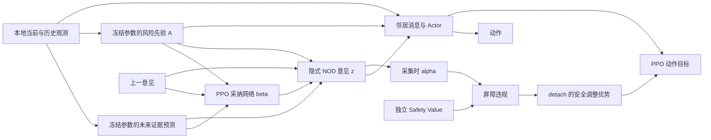

# 预测与采纳分工的非线性意见安全控制：技术方案与论文写作依据

更新日期：2026-10-14。用途：统一论文的问题定义、机制解释、网络结构、损失、训练流程与理论性质；保留可追溯的候选结果，供正式写作使用。

本文主线为：**监督预测邻车未来风险缓解 → 强化学习证据采纳强度 β → 具有历史记忆的非线性意见 z → 分散动作策略与训练期安全约束。** A 的风险关注参数在候选监督阶段间接学习，控制阶段冻结；β 由 PPO 学习，专门决定新预测如何融入意见。固定 \(b=0,s=1,v_0=1\)，不同时学习自由方差。

这次主线选择明确采用**独立 β 扩展**，不再把“原共享 A、整个 NOD 冻结”作为正文方法。原共享 A 方程是基线，在 \(\beta=A\) 时恢复；正文扩展将风险相关自强化与任务驱动证据采纳分开。保留原公式结构的 PPO 共享 A 是另一候选，不能与本文机制或结果混写。

正文给出完整方法，附录记录已测性能、取舍与其他方案。完整历史见[探索记录](../archive/LEARNING_IN_NOD_EXPLORATION_RECORD.md)。本次是技术文档重构，复用已实现、已训练的短序列 β 分支，不切换项目默认模型，也不修改运行代码或要求重新训练。

## 1. 研究问题：预测邻车，与决定本车如何响应

### 1.1 核心矛盾

异构交通中，本车只能观察邻车运动，不能在执行时依赖邻车通信、策略类型或未来动作计划。当前减速可能来自让行、转弯、前车阻挡或其他冲突，因此“是否刹车”并不能直接定义合作意图。

本文预测一个由未来轨迹定义的量：**在给定本车运动参考和未来窗口内，邻车实际运动能够相对参考运动缓解多少接近风险。** 这一目标可在训练轨迹上计算和核对，而不是为邻车主观意图造标签。

但知道邻车可能提供多少缓解，并不等于知道本车应如何使用这项预测。相似的预测在不同距离、历史意见和本车状态下，可能需要不同响应。固定采纳强度将预测内容与控制使用方式绑定；将整个预测器交给回报优化，又会允许其输出偏离原有物理语义。

因此，本文将**预测内容**和**预测的控制采纳方式**分开学习：监督学习约束预测内容，强化学习根据安全调整的任务反馈决定采纳强度，再由显式意见动力学连接二者。

### 1.2 四个量的职责

| 量 | 回答的问题 | 学习方式 | 不能等同于 |
| --- | --- | --- | --- |
| \(\hat e_t\) | 邻车未来相对参考能提供多少风险缓解？ | 未来轨迹软标签监督；控制阶段冻结预测器 | 邻车真实合作意图 |
| \(A_t\) | 当前风险对意见自强化应有多大影响？ | 经候选意见损失间接学习；控制阶段冻结参数 | PPO 学到的 β，或不变常数 |
| \(\beta_t\) | 当前预测应以多大强度融入动态意见？ | 安全调整优势下的 PPO；没有 β 标签 | 预测置信度、误差方差、合作程度 |
| \(z_t\) | 历史与新预测融合后，形成怎样的控制交互判断？ | 隐式 NOD 状态更新；控制阶段参与 PPO 梯度链 | 已校准的未来概率、直接动作命令 |

“冻结 A”只固定映射参数，其数值仍随当前物理风险变化。“冻结预测器”只固定 GRU 和预测头参数，其历史状态及预测仍在线更新。β 和 z 都会随交互变化。

### 1.3 方法定位

可将方法概括为**预测—采纳分工的意见驱动安全学习**：预测层提供可核对的未来缓解估计，采纳层学习该估计的任务相关使用强度，意见层提供有界、具有历史惯性的交互状态，控制层学习相应动作并利用意见调整训练期安全压力。

本文不要求 \(q_{ij}+q_{ji}=1\)，不将物理安全距离拆成可交接的责任份额。邻车预计提供更多缓解时，本车可以在训练中接受较快的安全余量下降；预计缓解不足时，本车承受更严格的避让训练压力。这是自适应风险响应，不能解释为另一辆车必然补足确定责任。

## 2. 符号、观测与有效交互

所有成对量针对有方向的交互 \(i\rightarrow j\)，省略车辆下标时仍指同一条边。

| 符号 | 含义 |
| --- | --- |
| \(x_{ij,t}\) | 当前局部成对运动特征，20 维 |
| \(h_{ij,t}\) | GRU 编码的因果历史，64 维 |
| \(e^{\mathrm{geom}}_{ij,t}\) | 已观察运动和交互参考产生的当前几何证据 |
| \(q^*_{ij,t}\in[0,1]\) | 由训练轨迹未来窗口计算的风险缓解软标签 |
| \(e^*_{ij,t}=2q^*_{ij,t}-1\) | 中心化的未来监督目标 |
| \(\hat q_{ij,t},\hat e_{ij,t}\) | 从当前和过去信息预测的缓解量及其中心化值 |
| \(r_{ij,t}\) | 非负物理风险分量，6 维 |
| \(A_{ij,t}\in(0,1)\) | 监督阶段间接学习、控制阶段冻结参数的风险关注先验 |
| \(\beta_{ij,t}\in(0,1)\) | PPO 学习的证据采纳强度，仅调节证据项 |
| \(z_{ij,t}\in(-1,1)\) | 具有历史记忆、面向控制的风险缓解意见 |
| \(\rho(z)=(z+1)/2\) | 意见的单位区间表示；候选阶段用于监督拟合，控制阶段不是校准概率 |
| \(v_0\) | 固定证据尺度，当前为 1 |
| \(V_{i,c}(s)\) | 本车第 c 个约束的 Safety Value，零为其安全边界 |
| \(\alpha_{ij,t}\) | 意见调节的成对屏障系数 |

必须区分“看得见邻车”和“正在发生有意义的交互”。可见掩码维护历史；交互掩码决定意见和监督是否有效。没有潜在冲突时意见记为 N/A，内部数值置零，但此时的零不表示邻车承担了一半缓解。

车辆身份与代际标记处理邻居切换和车辆重生。新边先以中性意见建立状态，保留身份后才参与意见更新和监督。短暂不可见可保留状态，当前保留期限为 2 步；交互失效清除对应意见，身份变化清除原历史。监督还要求未来窗口完整且身份连续，不能跨重置拼接标签。

当前采用局部运动学模式，不输入邻车未来路线。相对位置、速度和当前感知信息允许作为输入；真实未来轨迹只用于训练目标。

20 维输入保留既有检查点布局：相对位置 2 维、相对速度 2 维、航向差正余弦 2 维、距离/接近速度/TTC 各 1 维、路径相关槽位 7 维、接近程度/可见标记/本车速度/邻车速度各 1 维。local_kinematics 模式将 7 个路径相关槽位置零；20 维网络接口不等于使用 20 个独立有效传感量。

实现：[interaction.py](../../utilities/nod_marl/interaction.py)、[opinion.py](../../utilities/nod_marl/opinion.py)。

## 3. 未来风险缓解目标

### 3.1 固定本车参考的轨迹比较

交互开始时保存当前可知的速度参考 \(v_i^{\mathrm{anc}},v_j^{\mathrm{anc}}\)。在时刻 t，以这些速度形成未来 H 步的参考运动：

\[
\bar p_i(t+k)=p_i(t)+k\Delta t\,v_i^{\mathrm{anc}},\qquad
\bar p_j(t+k)=p_j(t)+k\Delta t\,v_j^{\mathrm{anc}}.
\]

本车参考在两种风险计算中保持相同。设邻车训练轨迹中的真实未来位置为 \(p_j(t+k)\)，定义：

\[
R_t^0=\max_{1\leq k\leq H}
\exp\!\left(-\frac{\|\bar p_i(t+k)-\bar p_j(t+k)\|}{d_s}\right),
\]
\[
R_t^{\mathrm{obs}}=\max_{1\leq k\leq H}
\exp\!\left(-\frac{\|\bar p_i(t+k)-p_j(t+k)\|}{d_s}\right),
\]
\[
q_t^*=\operatorname{clip}\!\left(
\frac{R_t^0-R_t^{\mathrm{obs}}}{\max(R_t^0-R_s,\epsilon_R)},0,1
\right),\qquad e_t^*=2q_t^*-1.
\]

当前 \(H=20,\Delta t=0.05\,\mathrm{s}\)，即未来 1 s；\(d_s=0.2,R_s=\exp(-1),\epsilon_R=10^{-6}\)。交互速度参考最长保持 2 s。参数采用本项目的仿真尺度。

\(q^*=0\) 表示邻车相对该参考没有提供正向缓解；\(q^*=1\) 表示按该风险模型已提供足够缓解；中间值表示部分缓解。裁剪也意味着负向风险变化统一记为零缓解，而不是区分所有恶化程度。

### 3.2 在线证据与未来标签

\(e_t^{\mathrm{geom}}\) 使用已观察的邻车运动和因果参考，并结合局部恒速接近预测计算，是当前可用的提示。\(q_t^*\) 使用未来真实邻车轨迹，作为训练目标。两者共享风险缓解语义，但不是相同计算量。

具体地，令相对位置为 d，给定相对速度 u 的连续恒速最近接近风险为：

\[
t_c(d,u)=\operatorname{clip}\!\left(-\frac{d^\top u}{\max(\|u\|^2,10^{-8})},0,H\Delta t\right),
\qquad R^{\mathrm{CV}}(d,u)=\exp(-\|d+t_c(d,u)u\|/d_s).
\]

有效交互内，基准使用两车锚定速度，观察项只将邻车速度替换为当前观察值：

\[
R_t^{\mathrm{anc}}=R^{\mathrm{CV}}(p_j-p_i,v_j^{\mathrm{anc}}-v_i^{\mathrm{anc}}),
\quad R_t^{\mathrm{cur}}=R^{\mathrm{CV}}(p_j-p_i,v_{j,t}-v_i^{\mathrm{anc}}),
\]
\[
q_t^{\mathrm{geom}}=\operatorname{clip}\!\left(
\frac{R_t^{\mathrm{anc}}-R_t^{\mathrm{cur}}}{\max(R_t^{\mathrm{anc}}-R_s,\epsilon_R)},0,1\right),
\qquad e_t^{\mathrm{geom}}=2q_t^{\mathrm{geom}}-1.
\]

无有效交互时该证据置零且标记无效。交互开始还要求当前运动处于接近状态，参考保持、超时与锁定逻辑由状态机管理。在线几何量采用连续最近接近，未来标签采用真实轨迹的离散窗口最大风险；即使采用相同窗口长度，也不能将二者视为同一标签的重复计算。

学习未来证据的价值在于预测尚未观察到的运动结果，而不是重新拟合已经能够直接计算的当前几何量。

固定本车参考，避免将本车实际未来刹车造成的距离变化直接计入邻车缓解。但邻车运动仍可能受本车影响，因此这是**指定参考下的轨迹对比指标**，不是独立因果合作性的识别。标签适用性取决于参考运动、风险模型和预测窗口。

实现：[counterfactual.py](../../utilities/nod_marl/counterfactual.py)。

## 4. NOD 网络：预测证据与风险关注

### 4.1 因果历史与未来证据预测

\[
h_t=\operatorname{GRU}_\phi(x_t,h_{t-1}),\qquad
\hat q_t=\operatorname{sigmoid}(f_\phi([h_t,e_t^{\mathrm{geom}}])),
\qquad \hat e_t=2\hat q_t-1.
\]

| 模块 | 当前结构 | 输出 |
| --- | --- | --- |
| 历史编码 | GRUCell(20,64) | 64 维历史状态 |
| 未来证据头 | Linear(65,64) → Tanh → Linear(64,1) → Sigmoid | \(\hat q_t\) |
| 中心化映射 | \(2\hat q_t-1\) | \(\hat e_t\in(-1,1)\) |

预测头末层零初始化，初始 \(\hat q=0.5\)。显式加入 \(e^{\mathrm{geom}}\)，使网络利用交互参考产生的证据，不必完全从隐藏向量重建参考信息。

### 4.2 风险关注 A

\[
A_t=\operatorname{sigmoid}\!\left(
T_r\left[\sum_{m=1}^{6}\omega_m r_{m,t}-c_r\right]\right),
\qquad \omega_m=\omega_{\max}\operatorname{sigmoid}(u_m),\quad \omega_{\max}=1.
\]

风险分量包含接近距离、接近程度、逆 TTC、冲突指示、到达时间紧迫度和重叠程度。当前局部运动学模式清零了邻车路径相关槽位，因此不能假定六项都提供有效变化；主要有效变化来自距离、接近程度和 TTC。

当前 \(T_r=2,c_r=1.25\)，六个权重初始值为 [0.75,0.75,0.50,0.50,0.50,0.75]，在 [0,1] 内参数化。

A 基于物理风险计算，不由 GRU 直接输出。非负权重使 A 对单个风险分量结构上非递减。参数在候选监督阶段通过意见损失学习，**没有单独的 A 监督标签**；控制阶段冻结这些参数。

### 4.3 固定证据映射与尺度

主线采用：

\[
b_t=0,\qquad s_t=1,\qquad v_t=v_0=1.
\]

固定 b 防止模型通过自由偏置移动意见零点；固定 s 保持证据与意见的同一中心化尺度。\(v_0\) 只作为固定动力学尺度，不输出可校准的不确定性。主线不学习方差，不使用过滤后未来预测头或分位数下界；控制阶段另行学习独立 \(\beta\)，见第 5 节。

实现：[opinion.py](../../utilities/nod_marl/opinion.py)。

## 5. PPO 学习证据采纳强度 β

### 5.1 为什么将 β 与 A 分开

原共享 A 更新中，A 同时影响自强化与证据项。增加 A 既可能加强历史意见，也可能拉向新证据，不能将其全部变化解释为“更重视预测”。本文保留 A 的风险先验作用，新增仅位于证据项的 β，以限定控制学习的作用位置。

这是一项明确的动力学扩展，不是给原 A 换名称。它的价值在于职责和局部作用可分析；并不由此保证比共享 A 或固定权重表现更好。

### 5.2 有界残差参数化

令采纳网络的因果输入为：

\[
c_t=[h_t(64),r_t(6),A_t(1),\hat e_t(1),z_{t-1}(1)]\in\mathbb R^{73}.
\]

\[
\bar A_t=\operatorname{clip}(A_t,10^{-6},1-10^{-6}),\qquad
\boxed{\beta_t=\operatorname{sigmoid}\!\left[
\operatorname{logit}(\bar A_t)+c_\beta\tanh(g_\theta(c_t))\right].}
\]

\(g_\theta\) 为 Linear(73,32) → Tanh → Linear(32,1)，共 2401 个可训练参数，\(c_\beta=2\)。末层权重与偏置零初始化，因此初始 \(\beta=\bar A\)，从已有固定权重控制器附近开始训练。

参数化的作用是围绕风险先验作有界 logit 修正，而不是完全重新构造权重。对有效交互有：

\[
\left|\operatorname{logit}(\beta_t)-\operatorname{logit}(\bar A_t)\right|\leq c_\beta,
\]
\[
e^{-c_\beta}\frac{\bar A_t}{1-\bar A_t}
\leq\frac{\beta_t}{1-\beta_t}
\leq e^{c_\beta}\frac{\bar A_t}{1-\bar A_t}.
\]

这是权重变化范围的结构约束，不是动作信赖域或安全保证。β 不必对每个风险分量单调；风险先验 A 的单调性不能自动移植到 β。

β 只用当前或过去信息，先由上一意见计算，再固定其数值求解当步 \(z_t\)，避免把 β 网络与当步未知意见组成新的代数闭环。无有效且已建立身份历史的交互时，代码将学习权重置零，不推进这条边的有效意见。

### 5.3 β 的控制学习语义

β 没有“正确强度”的监督标签、独立奖励或专属 Critic。它与 Actor、消息网络共同接受 PPO 动作目标和熵项的梯度。优化问题是在现有状态和控制器下学习怎样采纳预测，而不是估计预测误差概率。

A、β 与消息 softmax 权重是三个不同量：A 影响意见自强化并提供风险先验；β 调节证据融入意见；消息权重决定邻居消息聚合。论文不宜将三者统一称为同一种 attention。

实现：[policy.py](../../utilities/nod_marl/policy.py)。

## 6. 风险关注与证据采纳分离的意见动力学

### 6.1 隐式更新

对有效且已建立身份历史的交互边，令 \(\lambda_z=\tau/\Delta t\)：

\[
\boxed{
\lambda_z[\operatorname{atanh}(z_t)-\operatorname{atanh}(z_{t-1})]
=-z_t+A_t\tanh(a z_t)+\frac{w\beta_t}{v_0}(\hat e_t-z_t).
}
\]

当前 \(\tau=0.25\,\mathrm{s},\Delta t=0.05\,\mathrm{s},\lambda_z=5,a=2,w=1,v_0=1\)。监督候选阶段取 \(\beta_t=A_t\)，恢复原共享 A 更新；控制阶段 β 由 PPO 采纳网络计算。

| 项 | 作用 |
| --- | --- |
| atanh 差分 | 在有界状态几何中保留历史惯性 |
| \(-z_t\) | 对意见提供衰减 |
| \(A_t\tanh(a z_t)\) | 风险相关的非线性自强化 |
| \((w\beta_t/v_0)(\hat e_t-z_t)\) | 以可学习采纳强度将意见拉向预测证据 |

这里的 z 是面向控制的动态缓解意见。候选阶段用未来缓解监督它；引入 PPO β 后，不再要求其始终等于未来缓解预测。正 z 表示当前交互判断偏向较充分缓解，负 z 表示偏向缓解不足；历史惯性允许它与当步证据暂时不同号。

### 6.2 等价目标与单步良定性

定义 \(\rho(z)=(z+1)/2\)。固定当步 A、β、预测证据及上一意见时，上式是以下标量目标的一阶条件：

\[
\Phi_t(z)=\frac{z^2}{2}-\frac{A_t}{a}\log\cosh(az)
+\frac{w\beta_t}{2v_0}(z-\hat e_t)^2
+\lambda_z D_{\mathrm{KL}}\!\left(
\operatorname{Bern}(\rho(z))\|
\operatorname{Bern}(\rho(z_{t-1}))\right).
\]

Bernoulli KL 仅定义意见更新的几何，并不证明 \(\rho(z)\) 是校准概率。曲率为：

\[
\mathcal H_t(z)=\frac{\lambda_z}{1-z^2}
+1-A_ta\operatorname{sech}^2(az)+\frac{w\beta_t}{v_0}.
\]

若 \(0\leq A_t\leq1,\beta_t\geq0,w\geq0,v_0>0,\lambda_z>0,a>0\)，且 \(\lambda_z+1>a\)，则：

\[
\mathcal H_t(z)\geq\lambda_z+1-a>0.
\]

对内部历史状态 \(z_{t-1}\in(-1,1)\)，目标严格凸；一阶导数在两个端点分别趋向负、正无穷，存在唯一内部极小点。该结论针对每步固定输入的隐式问题，不保证整个时变闭环稳定。当前参数满足该充分条件。

实现采用区间 \((-1+10^{-4},1-10^{-4})\) 内的二分求根，最多 48 次，残差停止阈值 \(10^{-7}\)。反向传播采用隐式导数，而非将全部求根迭代展开；边界截断的解按代码规则令该求解器梯度为零。精确解性质应与数值误差、裁剪行为区分。

### 6.3 可解释的局部作用

在上述良定条件下，固定其他输入：

\[
\frac{\partial z_t}{\partial\hat e_t}
=\frac{w\beta_t}{v_0\mathcal H_t(z_t)}\geq0,
\qquad
\frac{\partial z_t}{\partial\beta_t}
=\frac{w(\hat e_t-z_t)}{v_0\mathcal H_t(z_t)}.
\]

更正向的预测不会降低固定 β 时的单步意见。增加 β 将意见向预测证据方向拉动：它可以加强正意见，也可以加强负意见，不能解释为“β 越大越合作”或“β 越大越安全”。这正是将 β 从 A 分离后的明确作用位置。

仍固定 β 和其他输入时：

\[
\frac{\partial z_t}{\partial z_{t-1}}
=\frac{\lambda_z}{(1-z_{t-1}^2)\mathcal H_t(z_t)}>0,
\qquad
\frac{\partial z_t}{\partial A_t}
=\frac{\tanh(az_t)}{\mathcal H_t(z_t)}.
\]

A 在此只影响自强化；其作用方向依赖意见符号。当 \(\hat e_t=z_{t-1}=0\) 时，唯一解为零，保持中性零点。固定 b=0 防止自由偏置移动该零点，但不保证实际输入数据、预测误差或状态分布具有对称性。

这些都是求解器的偏导。由于 β 网络也读取证据、历史和 A，完整网络的全导数还包含 β 的变化；不能直接将上述偏导写成任意观测变化下的单调性、时间收缩性或闭环动作性质。

实现：[opinion.py](../../utilities/nod_marl/opinion.py)。

## 7. 候选监督损失与语义锚定

### 7.1 损失函数

监督候选阶段取 \(\beta=A\)，尚不训练独立采纳网络。设 M 为有效监督掩码：当前可见、交互有效、历史身份已建立、未来窗口完整且代际连续。只在 M 上平均：

\[
\mathcal L_{\mathrm{forecast}}
=\mathbb E_M[\operatorname{BCE}(\hat q_t,q_t^*)],
\]
\[
\mathcal L_{\mathrm{opinion}}
=\mathbb E_M[\operatorname{BCE}(\rho(z_t^{\mathrm{SL}}),q_t^*)],
\qquad
\boxed{\mathcal L_{\mathrm{candidate}}=
\mathcal L_{\mathrm{forecast}}+\mathcal L_{\mathrm{opinion}}.}
\]

\(z^{\mathrm{SL}}\) 表示监督阶段的意见，同一隐式求解器此时在两个位置使用 A。两项权重均为 1，BCE 概率输入裁剪至 \([10^{-6},1-10^{-6}]\)。不加入旧观测证据 NLL、几何教师 Huber 或分位数损失。

| 参数 | 候选监督梯度来源 | 控制阶段 |
| --- | --- | --- |
| GRU、未来证据头 | 预测 BCE；经隐式意见的意见 BCE | 冻结参数 |
| 风险关注权重 | 经隐式意见的意见 BCE；两个 A 位置均贡献梯度 | 冻结参数 |
| 独立 β 网络 | 此时不存在，不拟合 β 标签 | PPO 更新 |
| b、s、v | 固定，不学习 | 固定 |
| Actor、消息网络 | 不接受候选监督梯度 | PPO 更新 |

因此，“监督学习 e 和 A”是学习分工的简称：e 有明确未来目标，A 没有单独标签，通过意见目标间接学习。控制学习阶段冻结这一语义来源，避免 PPO 为提高回报任意改写未来证据头。

### 7.2 为什么不是只用监督或只用强化学习

监督 e 能约束一个可由未来轨迹检验的预测对象，但标签只是指定参考和风险模型下的软目标，不代表绝对正确的意图真值。只对 β 造标签则需要预先知道控制器在每个状态下怎样使用预测，难以从轨迹风险缓解值直接推导。

PPO 学习 β，允许采纳策略根据任务反馈调整，同时保持 e 的监督语义。固定预测器限制了回报梯度的改写范围；它不消除预测误差，也不保证预测在新分布上仍准确。

完全用 RL 学习 e 是可选设计，但若没有预测监督，e 可能成为任意潜在控制编码，难以继续称为未来缓解预测。当前未完成完全 RL e 的直接对照，不能写成其性能必然更差。

单独软标签 BCE 在理想函数容量下的最优解为条件均值；联合意见损失、有限容量和分布变化使这一结论不自动成为当前预测器的校准保证。\(\hat q\)、\(\rho(z)\)、A 与 β 都不作为具有覆盖保证的安全下界。

实现：[trainer.py](../../utilities/nod_marl/trainer.py)。

## 8. Actor 的消息结构与执行

每条可见邻居边采用：

\[
\xi_{ij,t}=[h_{ij,t}(64),r_{ij,t}(6),A_{ij,t}(1),z_{ij,t}(1)]\in\mathbb R^{72}.
\]

消息网络为 LayerNorm(72, affine=False) → Linear(72,64) → Tanh → Linear(64,32) → Tanh。共享线性打分头与 masked softmax 聚合有效邻居，聚合结果经过 \(0.1\tanh\) 限幅。

Actor 输入为本车原始观测、32 维消息和 2 维上一动作。Actor 是共享参数的分散式 MLP，两层各 256 个 Tanh 单元，输出二维动作的分布参数，通过有界 TanhNormal 产生动作。

部署需要本地运动观测、在线 NOD 状态、β 网络、消息网络和 Actor。任务 Critic 与 Safety Value 仅服务训练；真实未来轨迹、邻车规则类型与通信计划不进入学习车辆的动作输入。

β 不作为新的标量坐标直接拼入 Actor 消息，其学习路径经由 z。Actor 同时接收 h、r 和 A，因此 z 不是全部邻居信息的唯一入口。技术贡献可以表述为提供具有物理语义和历史演化的交互通道；仅凭结构不能声称 Actor 必然使用 z。

任务 Critic 采用共享参数的集中式两层 256 单元 Tanh MLP，训练时读取各车观测并输出各车任务价值；它与分散式 Actor 的输入权限不同，部署时移除。本文是集中训练、分散执行，无通信约束针对学习车辆的执行输入，不要求所有训练组件分散。

实现：[policy.py](../../utilities/nod_marl/policy.py)、[mappo_cavs.py](../../utilities/mappo_cavs.py)。

## 9. 意见驱动的安全学习

### 9.1 独立 Safety Value 网络与损失

PairSafetyValue 与任务回报 Critic 分开，预测成对、道路和实际碰撞约束的风险值，不预测合作标签。

| 部件 | 结构 |
| --- | --- |
| 成对编码 | Linear(20,64) → Tanh |
| 本车编码 | Linear(\(D_o+2\),64) → Tanh |
| 邻居汇聚 | 成对编码的 masked mean |
| 成对风险头 | 拼接边、本车与汇聚编码；Linear(192,64) → Tanh → Linear(64,1) |
| 本地风险头 | 拼接本车与汇聚编码；Linear(128,64) → Tanh → Linear(64,2) |

设有符号物理约束为 \(g_{t,c}\)，安全侧为非正。DGPPO 风格目标采用跨约束最坏即时风险 \(g_t^{\max}=\max_{c\text{ 有效}}g_{t,c}\)。在连续有效片段上：

\[
B_{t,c}^{(1)}=
\max\{g_{t,c},(1-\gamma_V)g_t^{\max}+\gamma_V V_{\mathrm{pre},c}(s_{t+1})\},
\]
\[
B_{t,c}^{(n)}=
\max\{g_{t,c},(1-\gamma_V)g_t^{\max}+\gamma_V B_{t+1,c}^{(n-1)}\}.
\]

真终止用已观察后继 \(g_{t+1,c}\) 替代 bootstrap；身份中断结束可用片段，并使用该转移自身的 bootstrap。对可用长度 L：

\[
y_{t,c}=\sum_{n=1}^{L}\eta_n B_{t,c}^{(n)},\qquad
\eta_n=
\begin{cases}
(1-\lambda_V)\lambda_V^{n-1},&n<L,\\
\lambda_V^{L-1},&n=L.
\end{cases}
\]

\[
\mathcal L_V=\frac12\mathbb E_{\mathrm{valid}}
[(V_\psi(s_t,c)-\operatorname{stopgrad}(y_{t,c}))^2],
\quad \gamma_V=0.99,\ \lambda_V=0.95.
\]

bootstrap 使用本轮更新前的模型估值。这里是对非线性多步最大风险备份进行 λ 混合，不能写成先平均后取最大。当前成对安全距离参数为 0.25，道路余量为 0.01，与证据风险核的 \(d_s=0.2\) 用途不同。

### 9.2 意见调节成对屏障系数

只对身份对齐、意见有效、物理约束 \(g_{ij,t}\leq0\)、\(V_{ij}(s_t)<0\)、数值有限且 \(|z_{ij,t}|>0.1\) 的成对约束，采用：

\[
\alpha_{ij,t}=\alpha_0+\Delta\alpha\,\operatorname{clip}(kz_{ij,t},-1,1),
\qquad \alpha_0=10,\ \Delta\alpha=5,\ k=1.
\]

其余情况使用基础系数 10。道路和实际碰撞头不由意见调节。允许的成对系数范围为 \([5,15]\)。

\[
\delta_{ij,t}=
\frac{V_{ij}(s_{t+1})-V_{ij}(s_t)}{\Delta t}
+\alpha_{ij,t}V_{ij}(s_t).
\]

在安全侧，正意见使同一转移的 δ 更小，负意见使其更大。它调整接近风险边界的训练压力，不缩小物理距离，也不保证邻车补足确定份额。危险侧不因正意见放宽。

### 9.3 安全优势与 PPO

设 \(\widehat{\mathcal A}^{\mathrm{task}}\) 为任务 Critic 的 GAE，\(\mathcal C_t\) 为身份连续且估值有效的约束集合。对信息完整或已发现明确违规的样本：

\[
\widehat{\mathcal A}_t=
\mathbf1_{\{\nexists c\in\mathcal C_t:\delta_{c,t}>0\}}
\widehat{\mathcal A}^{\mathrm{task}}_t
-\kappa\max_{c\in\mathcal C_t}[\delta_{c,t}+\epsilon_s]_+,
\qquad \kappa=1,\ \epsilon_s=0.01.
\]

没有已知违规且约束后继不完整时回退任务优势；缺失邻居不能抹去其他已知违规。门控判断使用 \(\delta>0\)，惩罚使用 \([\delta+\epsilon_s]_+\)，两者阈值不同。

令 \(\mathscr H_t\) 表示该步可用的因果观测与回放历史，ψ 为 Actor/消息参数，θ 为 β 参数。概率比为：

\[
R_{\psi,\theta,t}=\frac{\pi_{\psi,\theta}(u_t\mid\mathscr H_t)}
{\pi_{\mathrm{old}}(u_t\mid\mathscr H_t)}.
\]

分母使用采集时缓存的旧动作对数概率，分子按当前参数重算 β、意见、消息和动作分布。以下简记为 R：

\[
\mathcal L_{\mathrm{PPO}}=
-\mathbb E[\min(R\widehat{\mathcal A}_t,
\operatorname{clip}(R,1-\epsilon_P,1+\epsilon_P)\widehat{\mathcal A}_t)]
-c_H\mathbb E[\mathcal H(\pi_{\psi,\theta})],
\quad \epsilon_P=0.2,\ c_H=10^{-4}.
\]

任务 Critic 独立回归任务价值目标；任务折扣为 0.99，GAE λ 为 0.9。Safety Value 以 \(\mathcal L_V\) 更新，两者不与未来证据 BCE 混成同一个目标。

任务目标保留原任务 GAE 得到的 value_target，不用安全门控后的优势替换价值标签。记目标为 \(\widehat U_t\)、任务价值为 \(U_\nu\)，本地 TorchRL 的 ClipPPOLoss 默认采用系数为 1 的 smooth-L1 回归：

\[
\mathcal L_{\mathrm{taskV}}=\mathbb E[\ell_{\mathrm{Huber}}(U_\nu-\operatorname{stopgrad}(\widehat U_t))],
\qquad
\ell_{\mathrm{Huber}}(d)=
\begin{cases}d^2/2,&|d|<1,\\|d|-1/2,&|d|\geq1.\end{cases}
\]

当前 PPO 更新中任务价值项与动作目标/熵项相加，但没有通向 β 的任务 Critic 梯度；Safety Value 使用另一优化器和物理风险目标。未来改变 TorchRL 版本或显式配置 critic loss 时，应同步这一实现细节。

实现：[dgppo.py](../../utilities/nod_marl/dgppo.py)、[safety_value.py](../../utilities/nod_marl/safety_value.py)。

## 10. 分阶段训练、短序列回放与梯度边界

### 10.1 阶段一：独立训练未来证据候选

固定 behavior Actor、消息、behavior NOD、任务 Critic 和 Safety Value 采集轨迹；独立 learner NOD 由完整未来窗口计算目标并优化 \(\mathcal L_{\mathrm{candidate}}\)。learner 的变化不改变 behavior Actor 的输入，避免候选预测器在拟合期间立即改变自己的采样策略。

当前使用预训练行为源 reward7.21，而非整个系统从头训练。候选训练 30 轮，Adam 学习率 \(10^{-3}\)，每批 4 个监督 epoch，32 步有序序列，每小批最多 8 个环境。序列内递推 GRU 与意见，窗口边界截断历史梯度。

### 10.2 阶段二：建立固定采纳控制器

将候选预测器接入策略，冻结 GRU、证据头、A 和固定尺度；此时 \(\beta=A\)，不创建独立采纳网络。先以未来证据完成固定权重安全控制训练，得到 reward7.08，为阶段三提供完整控制初始化。

此分支完成 70 轮：20 轮 Safety Value warmup，50 轮 Actor/消息/任务 Critic 与 Safety Value 控制训练。Actor/消息初始学习率均为 \(5\times10^{-5}\)，最多 60 epochs，KL 阈值 0.01。它既是主线的预备控制器，也是固定采纳对照；不能把它的结果当成 β 主线结果。

### 10.3 阶段三：学习 β 并与 Actor 共同适应

已实现、已评估的主线从 reward7.08 完整检查点初始化，新增零残差 β 网络，再执行：

| 轮次安排 | Actor、消息、β | 其他模块 |
| --- | --- | --- |
| 1–20 | 全部冻结 | 只进行 Safety Value warmup；任务 Critic 的 PPO 更新也暂停 |
| 21–30 | 只更新 β；Actor/消息梯度置 None | 任务 Critic、Safety Value 继续训练 |
| 31–70 | β 与 Actor/消息联合微调 | 任务 Critic、Safety Value 继续训练 |

β 独训按实际发生 PPO 更新的批次数计数；若批次不执行 PPO，不推进阶段计数。上述轮次对应正常每轮发生更新的情况。预测器与 A 全程不更新，阶段计数随 Policy 保存。

| 设置 | 已测短序列 β 主线 |
| --- | --- |
| 环境与采样 | CPM_mixed；32 个并行环境 × 128 步 = 4096 帧/轮；训练配置 n_agents=4 |
| PPO 小批 | 512 帧；最多 60 epochs；clip=0.2；不跨车辆归一化优势 |
| Actor/任务 Critic 初始 LR | \(10^{-5}\) |
| 消息初始 LR | \(10^{-5}\) |
| β 初始 LR | \(5\times10^{-5}\) |
| 学习率衰减 | 沿用微调衰减；主组下限 \(2\times10^{-6}\)，其他组按相同比例 |
| KL 提前停止 | 0.01 |
| 梯度裁剪 | 全局范数上限 1 |
| 熵系数 | \(10^{-4}\) |
| 任务折扣、GAE λ | 0.99、0.9 |
| Safety Value | LR \(10^{-3}\)；每批 1 epoch；小批 512；\(\gamma_V=0.99,\lambda_V=0.95\) |
| 意见映射 | gain=1；死区 0.1；α 范围 [5,15] |
| 意见回放 | 8 步有序窗口 |

这是一条从已训练策略出发的分阶段路线，有额外控制训练预算。论文应同时报告初始化与累计预算，不能称为与固定权重分支等预算的一次单因素消融。阶段划分属于优化实现，不必单独包装为算法原创贡献。

### 10.4 有序意见回放

在线采集缓存冻结预测器的 h、风险分量、A、预测证据、上一意见、尺度和有效标记。PPO 不再次推进在线 GRU，而在缓存上重算 β 与意见。

每个环境 128 步切为 16 个 8 步窗口；窗口随机打乱，窗口内部保持时间顺序，64 个窗口组成 512 帧小批。窗口首步以 detach 的采集前意见为初值；连续有效的同一车辆对递推：

\[
\widetilde\beta_t=G_\theta(h_t,r_t,A_t,\hat e_t,\widetilde z_{t-1}),\qquad
\widetilde z_t=F(\widetilde z_{t-1},A_t,\hat e_t,\widetilde\beta_t).
\]

车辆重生、邻居身份改变、交互失效、缓存状态断开及可用终止标记切断该边的跨步梯度；窗口边界也截断。后一步动作损失因此可以沿意见状态影响前面 β 的学习，但冻结的 h、r、A、e 不进入梯度图。

这属于**通过意见状态的截断时间反向传播**，不是对整个历史、GRU 或仿真动力学的精确端到端梯度。当前参数重算的动作概率与缓存旧动作概率组成 PPO 比率；不是重新采样动作来替换原轨迹。

### 10.5 β 接收哪条梯度

在第 9.3 节 PPO 目标中，策略参数同时包含 Actor/消息参数 ψ 与 β 参数 θ：

\[
\pi_{\psi,\theta}(u_{i,t}\mid o_{i,t},m_{i,t}(\widetilde z;\theta)).
\]

单步概念链路为：

\[
\theta\rightarrow\beta_t\rightarrow\widetilde z_t
\rightarrow m_{i,t}\rightarrow\log\pi_{\psi,\theta}(u_{i,t})
\rightarrow\mathcal L_{\mathrm{PPO}},
\]

熵项也经过相同策略链路。隐式求解器的 \(\partial z/\partial\beta\) 见第 6.3 节。在连续回放内还包含历史递推项：

\[
\frac{d\widetilde z_t}{d\theta}
=F_\beta\frac{\partial G_\theta}{\partial\theta}
+\left(F_{z^-}+F_\beta\frac{\partial G_\theta}{\partial z^-}\right)
\frac{d\widetilde z_{t-1}}{d\theta}.
\]

偏导均在当前回放输入处计算，窗口首步历史梯度为零。这解释 β 为什么能获得动作反馈，以及为什么单步回放会截掉意见的跨步影响。

| 学习信号 | 更新对象 | 明确不反传至 |
| --- | --- | --- |
| 未来预测与候选意见 BCE | learner GRU、证据头、风险关注参数 | behavior 策略、真实未来轨迹、β |
| PPO 动作目标与熵 | β；开放阶段的 Actor/消息 | 冻结 h/e/A 参数；α；环境 |
| 任务价值回归 | 任务 Critic | 候选 NOD、β、Safety Value |
| 最大风险价值 MSE | Safety Value | 候选 NOD、Actor、β、风险标签构造 |

安全调整优势在采样后按**采集意见**计算并 detach，在同一批 PPO epochs 中固定。没有“屏障损失通过 α 直接反传 β”的实现。β 更新可改变下一轮采样的 z 与 α，并影响后续优势分布；这与当前批次对 α 求导不同。

### 10.6 整体流程



图中箭头表示前向依赖；G 到 L 提供固定优势，D/G/C/V 不在 β 的反向梯度路径上。预测器内部 h 与风险分量也进入消息，图中 O→M 概括这些直接上下文路径。

部署保留本地预测器、风险先验、β 网络、意见状态、消息与 Actor；去除任务 Critic、Safety Value、未来轨迹标签和训练用集中观测。规则车辆之间可以使用专门协调器，但该协调信息不作为学习车辆的部署输入。

实现：[gate_training.py](../../utilities/nod_marl/gate_training.py)、[policy.py](../../utilities/nod_marl/policy.py)、[mappo_cavs.py](../../utilities/mappo_cavs.py)。

## 11. 可以证明的性质及其适用范围

| 性质 | 条件或依据 | 可支持的结论 |
| --- | --- | --- |
| 目标有界且仅比较邻车轨迹改变 | 风险缓解裁剪、两种风险计算使用同一本车参考 | q*∈[0,1]；避免直接把本车实际未来刹车计入邻车缓解 |
| 因果执行 | 预测与采纳只读当前/历史；未来仅进标签 | 执行不读取真实未来轨迹或邻车动作计划 |
| A 的分量单调性 | 非负权重、其余风险量固定 | A 对单个风险分量非递减；不扩展至 β |
| β 有界先验修正 | sigmoid 与有界 logit 残差 | 权重 odds 相对 A 的倍率受限；不是安全保证 |
| 意见有界、精确单步解唯一 | 第 6.2 节严格凸条件及内部历史 | 更新良定，可隐式求导 |
| 中性零点 | b=0、s=1；e 与上一意见均为零 | 单步精确解为零；不推出样本正负比例对称 |
| β 的局部采纳作用 | 固定预测、A、历史与其他输入 | 增加 β 把该步 z 拉向 e |
| 排列不变的消息聚合 | 共享边编码/打分，历史随身份正确重排 | 同一邻居集合的聚合对排列不变 |
| 学习职责隔离 | 双 NOD 候选训练；控制冻结预测器 | PPO 不改写预测器参数；β 只在指定证据项作用 |

风险目标的定义不证明真实因果合作意图；PPO 也不保证收敛到最优 β。单步严格凸不等于意见序列全局收缩，不等于车辆闭环稳定。普通 GRU 是否可替代 NOD 是经验问题，不能仅用更新可分析性证明性能更好。

对 Value 屏障，若当前 \(V_t\leq0\)，该步真正满足 \(\delta_t\leq0\)，且 \(0<\alpha_t\Delta t\leq1\)，则：

\[
V_{t+1}\leq(1-\alpha_t\Delta t)V_t\leq0.
\]

当前 α∈[5,15]、dt=0.05 满足时间步条件。这是**精确满足屏障条件时的 Value 安全侧保持性质**。Safety Value 有近似误差，PPO 不逐动作强制该条件，也没有部署期硬安全过滤器；不能据此声称真实车辆零碰撞、必然无死锁或任意分布下安全。

固定 v0 不提供可校准不确定性，BCE 不提供下界覆盖保证，β 是任务驱动采纳强度。预测冻结保持参数职责，不保证控制分布变化后误差不变。

## 12. 论文叙事、贡献与写作素材

### 12.1 建议的问题展开

论文用一个矛盾贯穿：**对邻车未来运动的预测，不足以决定本车应该怎样使用这一预测。** 可按以下顺序展开：

1. 异构、无通信环境中，固定互惠假设难以适应不同邻车行为。
2. 单帧减速不能可靠定义合作意图；先定义可由未来轨迹核对的风险缓解目标。
3. 即使有预测，同样的预测在不同风险与历史下也未必应以相同强度采纳。
4. 直接用回报改写预测器会模糊预测语义，因此分开学习预测内容与采纳方式。
5. NOD 将二者连接成有界动态状态，再用于动作消息与训练期安全压力。

不必将所有尝试按时间写入引言，也不以“学习的参数更多”作为动机。本文的组织中心是学习职责分工及其可分析的连接。

### 12.2 方法概述，可直接用于中文初稿

> 本文提出一种面向异构交通的预测与采纳分工安全控制框架。首先，在固定本车运动参考下比较邻车真实未来与参考轨迹的接近风险，构造未来风险缓解监督目标，并从局部因果历史预测该目标。随后保持预测器和风险关注映射的参数固定，通过安全调整优势下的策略优化学习有界证据采纳强度，将未来预测融入非线性意见动力学。所得具有历史记忆的意见同时进入分散策略的邻居消息与训练期成对风险价值的屏障系数，连接可核对的行为预测和面向任务的控制决策。

方法名可使用“预测与采纳分工的意见驱动安全控制”；英文工作标题可用 *Predictive Evidence Assimilation for Opinion-Guided Safe Multi-Agent Control*。标题中的 safe 描述安全学习目标，摘要仍需说明不是无条件安全保证。是否使用新缩写属于后续写作选择，不由此文改变代码名称。

### 12.3 三项贡献的建议表述

1. **未来风险缓解的预测目标与因果估计。** 固定本车参考、比较邻车未来轨迹，给预测任务一个有方向、可核对的物理目标，并区分训练未来信息与执行输入。
2. **预测与控制采纳分开学习的意见机制。** 冻结监督预测器，利用 PPO 学习只作用于证据项的有界 β，在保留风险先验的同时调节预测融合；给出隐式更新的良定性、中性零点与局部采纳性质。
3. **意见与安全策略学习的连接。** 将动态意见接入邻居消息，并在训练中调节成对屏障优势，提供分散执行与明确的梯度边界；控制收益及各路径作用由对应实验检验。

这是贡献的组织建议，不是已完成全面检索后的“首次提出”结论。8 步回放、阶段冻结与小网络首先是实现手段，不宜把每一项都列为独立算法创新。

### 12.4 为什么需要 NOD，而不直接输入预测

预测头提供当前未来估计；GRU 编码运动历史；NOD 另外提供一个显式、低维、具有自强化与惯性的意见状态，其更新、采纳导数及安全映射可分析。β 学习的是这条结构化状态通道如何吸收新预测，不是任意替代整个历史编码。

这给 NOD 提供机制层面的理由，但其必要性仍需直接预测输入或普通历史融合对照。Actor 可读取 h、r、A，因此不能说所有信息都必须经过 z，也不能将单个控制改进归因于 NOD 的不可替代性。

### 12.5 与已有工作的边界

AVOCADO 已利用传感观测驱动非线性意见、适应未知合作程度并服务避碰，不能主张本文首次将意见动力学用于避碰。[AVOCADO 原论文](https://arxiv.org/abs/2407.00507)。

DGPPO 已研究离散图屏障与分散安全策略的共同学习；本文复用其安全学习思想，并在本项目的成对 Safety Value 与优势更新上引入意见调节，不能将整个原算法列为本文新贡献。[DGPPO 原论文](https://arxiv.org/abs/2502.03640)。

本文拟突出的具体组合是：未来轨迹定义的缓解预测、监督预测与 PPO 采纳的职责分离、具有可分析采纳作用的动态意见，以及它与消息/安全优势的连接。相关工作部分还需按正式稿件范围完成检索，避免未经检索的“首次”或“唯一”表述。

### 12.6 方法章节的安排

| 建议小节 | 要解决的问题 | 本文对应 |
| --- | --- | --- |
| Problem formulation | 无通信执行中能观察什么、预测什么？ | 第 1–3 节 |
| Predictive mitigation evidence | 目标怎么构造，预测器怎么训练？ | 第 3、4、7 节 |
| Task-driven evidence assimilation | 为什么有 β，怎样作用于意见？ | 第 5、6 节 |
| Opinion-guided safe policy learning | 意见如何影响动作与安全学习？ | 第 8、9 节 |
| Training and analysis | 梯度怎么走，哪些性质能证明？ | 第 10、11 节 |

正文不必复述每个历史检查点名称；复现细节进入附录或实现说明。已有结果见附录 A，尚未得到的机制隔离结论不能因叙事需要写成事实。

## 13. 复现锚点与实现对照

| 对象 | 本文主线对应文件 |
| --- | --- |
| 未来证据候选 | [config_dgppo_nod_future_evidence_candidate.json](../../configs/ablations/config_dgppo_nod_future_evidence_candidate.json) |
| 固定采纳预备控制器 | [config_dgppo_nod_future_evidence_control.json](../../configs/ablations/config_dgppo_nod_future_evidence_control.json) |
| 短序列 β 主线 | [config_dgppo_nod_future_evidence_ppo_gate_sequence_control.json](../../configs/ablations/config_dgppo_nod_future_evidence_ppo_gate_sequence_control.json) |
| 行为初始化前缀 | outputs/dependencies/dgppo_nod_responsibility_finetune/reward7.21 |
| 候选预测器 | outputs/current/ablations/dgppo_nod_future_evidence_candidate/final_nod.pth |
| 固定采纳初始化前缀 | outputs/current/ablations/dgppo_nod_future_evidence_control/reward7.08 |
| 主线已评估检查点前缀 | outputs/current/ablations/dgppo_nod_future_evidence_ppo_gate_sequence_control/reward7.16 |
| 核心机制 | [opinion.py](../../utilities/nod_marl/opinion.py)、[policy.py](../../utilities/nod_marl/policy.py) |
| 监督与控制训练 | [trainer.py](../../utilities/nod_marl/trainer.py)、[mappo_cavs.py](../../utilities/mappo_cavs.py) |
| 风险目标与安全学习 | [counterfactual.py](../../utilities/nod_marl/counterfactual.py)、[safety_value.py](../../utilities/nod_marl/safety_value.py)、[dgppo.py](../../utilities/nod_marl/dgppo.py) |

主线关键配置：

```text
nod_evidence_mode = learned
nod_evidence_target = future
nod_fixed_evidence_mapping = true
nod_variance_mode = fixed
nod_fixed_variance_value = 1
nod_nll_weight = 0
nod_freeze_training = true
nod_evidence_gate_mode = ppo
nod_evidence_gate_target = evidence  # 默认值；β 只用于证据项
nod_evidence_gate_hidden_dim = 32
nod_evidence_gate_max_logit_shift = 2
nod_evidence_gate_sequence_length = 8
nod_evidence_gate_only_iters = 10
dgppo_opinion_alpha = true
dgppo_alpha_gain = 1
dgppo_opinion_deadzone = 0.1
```

候选阶段为 nod_training_mode=candidate_only，冻结标记针对 behavior NOD，learner 仍监督学习；控制阶段 nod_training_mode=joint 且 nod_freeze_training=true，预测器实际冻结，但 Policy 内的 β 网络由 PPO 更新。不能只从 joint 或 freeze 名称推断全部模块是否更新。

β 位于 `_policy.pth`，冻结预测器位于版本 8 的 `_nod.pth`；任务 Critic 与 Safety Value 分别保存。应配套加载四个文件与配置，单个 NOD 侧文件不代表完整方法。`nod_evidence_gate_target=attention` 是共享 A 候选，使用不同语义契约，不能与 β 的 Policy 互换。

reward7.16 是训练采样回报对应的命名，不是独立评估得分；它位于第 43 轮，旧分支仍有更新前回报与更新后保存权重的时刻差异。附录性能来自保存检查点的独立评估。得分/权重对齐保存后来只在共享 A 联合适应候选实现，不能倒写为该 β 分支已具备的训练设置。

**论文主线与仓库默认运行入口分别管理。** 默认测试模型仍为 outputs/current/dgppo_nod_gain1_control_finetune/reward7.18；本文并未切换该默认。运行索引见 [EXPERIMENTS.md](../../EXPERIMENTS.md)。

## 附录 A. 已有性能证据与结论边界

### A.1 同协议控制评估

已有独立评估协议：intersection_2、环境种子 101、32 个并行仿真、1200 请求步长、确定性动作、关闭噪声与缓存复用。各分支按训练回报选取检查点。

| 方案 | 检查点 | 车车碰撞时间率 %↓ | 道路碰撞时间率 %↓ | 归一化速度 %↑ | 中心线偏差 %↓ | 动作变化 %↓ |
| --- | --- | ---: | ---: | ---: | ---: | ---: |
| 几何证据＋独立误差尺度 | reward7.38 | 0.22936 | 1.56380 | 83.27902 | 56.07506 | 7.24631 |
| 未来证据＋固定 β=A | reward7.08 | 0.17462 | 1.66024 | 82.71497 | 54.34002 | 7.48459 |
| 未来证据＋单步 PPO β | reward6.95 | 0.28148 | 1.19892 | 83.62932 | 49.22356 | 7.16872 |
| **未来证据＋分阶段短序列 PPO β，正文主线** | **reward7.16** | **0.09904** | **1.63678** | **81.70083** | **56.85823** | **7.84812** |
| 未来证据＋首轮 PPO 共享 A | reward7.34 | 0.23978 | 1.61854 | 82.95641 | 54.40619 | 7.50337 |
| 未来证据＋联合适应 PPO 共享 A | reward7.26 | 0.17723 | 1.73322 | 82.48520 | 58.36640 | 7.62916 |

短序列 β 相对固定 β=A，车车碰撞时间率相对降低约 **43.3%**，绝对下降约 **0.07558 个百分点**；归一化速度下降 **1.01414 个百分点**；道路碰撞时间率约降低 1.4%，中心线偏差增加约 4.6%，动作变化增加约 4.9%。因此，已有证据支持其在已测协议中提供更低车车碰撞时间率，伴随速度、偏差与平滑性取舍，不支持全部指标最优。

这比较的是完整训练分支。新增 β、短序列回放、独训阶段、额外预算与检查点选择同时存在，不能将 43.3% 改善全部归于 β 本身，也不能称为控制其他因素后证明的单机制效果。

碰撞指标是每个环境中至少一辆车出现相应碰撞的时间步比例，不是独立事故数量或逐车事故概率。速度优先使用整段未碰撞车辆，必要时回退全部车辆，不等于无条件车队吞吐量；中心线偏差以车宽归一化。32 个并行环境不等于跨 32 个环境种子的重复实验。当前均值不构成统计显著性、全场景优越性或 RL 共享 A 严格非劣性的证明。

原始结果：[未来证据与误差尺度](../../outputs/benchmarks/future_evidence_vs_variance_paper_metrics/intersection_2/steps_1200_envs_32_seed_101/metrics_summary.json)、[单步 β](../../outputs/benchmarks/future_evidence_ppo_gate_paper_metrics/intersection_2/steps_1200_envs_32_seed_101/metrics_summary.json)、[短序列 β](../../outputs/benchmarks/future_evidence_ppo_gate_sequence_paper_metrics/intersection_2/steps_1200_envs_32_seed_101/metrics_summary.json)、[首轮共享 A](../../outputs/benchmarks/future_evidence_ppo_attention_sequence_paper_metrics/intersection_2/steps_1200_envs_32_seed_101/metrics_summary.json)、[联合适应共享 A](../../outputs/benchmarks/future_evidence_ppo_attention_joint_paper_metrics/intersection_2/steps_1200_envs_32_seed_101/metrics_summary.json)。

### A.2 预测结果与控制结果分别说明什么

未来证据候选最后五轮平均意见 Brier 为 0.15899、意见—未来目标相关系数为 0.53749；独立误差尺度候选分别为 0.15858、0.50827。未来预测头自身 Brier 为 0.11000，当前几何证据直接对同一未来目标评分为 0.22906；预测 q 的 MAE 为 0.24769、平均偏差为 +0.01367。

这些是候选训练诊断，不是独立测试集泛化结论。预测头与融合后的 z 是不同输出，不能将预测头的 Brier 当作意见 Brier；也不能由融合后 Brier 较高直接推断 NOD 对控制无用。其作用首先是给未来预测任务提供依据；控制价值需看实际策略评估。

### A.3 β 的优化参与与后期退化

| 训练诊断 | 单步 β | 分阶段短序列 β |
| --- | ---: | ---: |
| PPO 小批次更新数 | 1348 | 18771 |
| 最后 20 轮平均 abs(β−A) | 0.00127 | 0.13285 |
| 最后 20 轮平均采样回报 | 6.26325 | 5.27406 |

短序列分支 β 独训期 Actor/消息参数位移为零，预测器监督更新全程为零；更新前回放探针近似 KL 最大约 \(1.4\times10^{-14}\)，支持缓存重算与采集的一致性。β 独训期动作探针平均变化仅约 \(7.84\times10^{-7}\)，说明参数有更新不等于既有 Actor 已强烈使用这条通道。

联合阶段 β 与 A 的偏离扩大，但后期采样回报下降；最高非 warmup 回报出现在第 43 轮，保存 reward7.16。独立评估使用该保存模型，而非最终模型。机制参与优化与最佳模型表现已有记录，但不能推导“更多 β 更新必然更好”。

训练记录：[单步 β](../../outputs/current/ablations/dgppo_nod_future_evidence_ppo_gate_control/reward6.95_data.json)、[短序列 β](../../outputs/current/ablations/dgppo_nod_future_evidence_ppo_gate_sequence_control/reward7.16_data.json)。训练中的逐车碰撞标记与 A.1 的环境碰撞时间率口径不同，不混用。

### A.4 论文可使用与不能使用的结果表述

可以写：

> 在已测交叉口协议中，采用监督未来证据与 PPO 采纳强度的分阶段短序列控制分支，相对固定采纳分支降低了车车碰撞时间率，同时存在归一化速度与动作平滑性的取舍。

方法分析可以证明更新结构、局部采纳作用和条件 Value 安全侧保持；现有训练记录可以确认 β 接收 PPO 梯度并发生更新。两类证据不应互相替代。

尚不能写成定论：β 单独造成全部改善；RL A 比监督 A 至少不弱；学习方差必然不如预测 e；NOD 必然优于普通 GRU；完整方法已在所有场景显著胜过所有 SOTA；预测标签是邻车真实意图。

论文撰写可以先固定方法定义。需要补充的结果应明确标为待测，例如累计预算匹配的固定采纳对照、直接预测/普通历史融合对照、跨种子与异构行为评估。这些是对特定结论的证据需求，不是要求继续增加机制才能开始写作。

## 附录 B. 其他候选的设计价值与取舍

### B.1 学习当前证据与学习未来证据不是同一任务

早期 learned e 拟合已经可由当前几何计算的教师量；未来证据头预测尚未观察到的轨迹缓解。当前几何拟合候选的证据 MAE 约 0.52，learner 从随机权重初始化也未恢复意见关联，因此不能把早期问题只归因于微调。

未来目标给 prediction learning 更明确的职责：它不是为一个可直接计算的当前量增加近似网络，而是用局部历史估计未来结果。该设计判断不等于证明所有当前证据学习都无用。

### B.2 学习误差尺度：合理备选，语义不同

独立误差尺度候选仍使用几何证据，以未来残差监督：

\[
\mathcal L_v=\frac12\left[
\frac{\operatorname{stopgrad}((e_t^{\mathrm{geom}}-e_t^*)^2)}{v_t}
+\log v_t+\log(2\pi)\right].
\]

意见更新对 v detach，以避免意见 BCE 操纵自己的尺度。其理想目标为条件预计平方误差，包含偏差，不能自动称为纯观测噪声方差。允许范围为 [exp(−5),4]，初始值为 1。

训练中预测尺度与实际误差的相关系数约 0.33196，高尺度组实际平方误差约为低尺度组的 4.56 倍，支持误差排序；低尺度组仍有低估，不能宣称独立校准完成。它适合回答“当前几何证据在哪些状态不可靠”，未来 e 则回答“尚未观察到的缓解可能是多少”，二者并无普遍优劣定理。

正文固定 v0=1，避免同时自由学习 β 与 v：在其他输入固定时，证据项只依赖 β/v，不同组合具有相同单步动力学。分别赋予误差尺度独立监督、β 控制职责才可能保持解释；本主线先只保留 β。

### B.3 原共享 A 的 PPO 学习

共享 A 候选令 PPO 输出同时作用于自强化与证据项，并进入 Actor 的 A 上下文：

\[
\lambda_z[\operatorname{atanh}z_t-\operatorname{atanh}z_{t-1}]
=-z_t+A_t^{\mathrm{RL}}\tanh(az_t)
+\frac{wA_t^{\mathrm{RL}}}{v_0}(\hat e_t-z_t).
\]

它保留原公式，却改变 A 的参数化与学习职责；A 的梯度既经 z，也经 Actor 的直接关注坐标。其局部导数为：

\[
\frac{\partial z_t}{\partial A_t^{\mathrm{RL}}}
=\frac{\tanh(az_t)+(w/v_0)(\hat e_t-z_t)}{\mathcal H_t(z_t)}.
\]

增加 A 不保证只将意见拉向预测，这与正文 β 的局部作用不同。首轮共享 A 与后续联合适应均已训练并独立评估，分别得到 reward7.34、reward7.26。

首轮后期采样回报退化，最后 20 轮均值为 4.73516。联合适应改为 20 轮 Safety warmup 后 50 轮 Actor/消息/A 联训、无 A 独训，最多 30 epochs、KL=0.005，并实现得分与权重时刻对齐保存；后期回报均值改善至 6.26800，但 A 相对先验平均偏移仅约 0.000881864。训练稳定性改善不能代替机制性能收益。

首轮车车碰撞时间率相对固定 A 增加约 37.3%；联合适应仍增加约 1.49%，五项均值均未优于固定分支。这支持记录为未获得控制收益的探索，而非证明共享 A 普遍无用。其结果不能作为正文 β 的结果，也不能作为“RL A 已证明不弱”的证据。

### B.4 固定 β=A 与未来分位数方案

固定 β=A 是最简基线：保留原共享 A 方程、控制阶段不学习意见内部权重。若首要要求为不改变原公式，这是现有结果中更合适的候选；本文选择 β 扩展是为了区分预测与采纳职责，并保留已测车车安全更低的候选，接受相应代价。

较早的过滤后 future_head、未来下分位数与独立校准下界是一条不同探索。它的输出位置、损失和安全接入不同，不能将其下界覆盖性质移到当前 evidence_head、β 或 z 上。主线不同时叠加这些机制。

## 附录 C. 文档维护与论文引用约定

- **本文**：论文主线采用监督未来 e、监督阶段间接学习且控制冻结的 A、PPO β，以及意见消息/安全优势双路径；以正文的符号、公式和梯度边界为准。
- [责任意见技术报告](RESPONSIBILITY_OPINION_TECHNICAL_REPORT.md)：较早的责任证据与理论资料；引用时统一为指定参考下的未来风险缓解，不沿用精确责任分配说法。
- [未来风险缓解报告](FUTURE_RISK_MITIGATION_OPINION_TECHNICAL_REPORT.md)：另一条预测头/分位数/保守下界探索；其保证不属于本文主线。
- [探索记录](../archive/LEARNING_IN_NOD_EXPLORATION_RECORD.md)：完整历史与候选诊断，其中历史推荐不定义当前论文方法。
- [实验索引](../../EXPERIMENTS.md)：运行入口、默认模型和输出记录，与论文主线分别管理。

新增结果先更新附录或实验索引。若决定更换正文方法，需同步预测对象、动力学、模块学习职责、梯度路径、对应配置、性能归属和论文段落。未完成结论用明确待测标记，不填入虚构数值或预设为已经成立。
